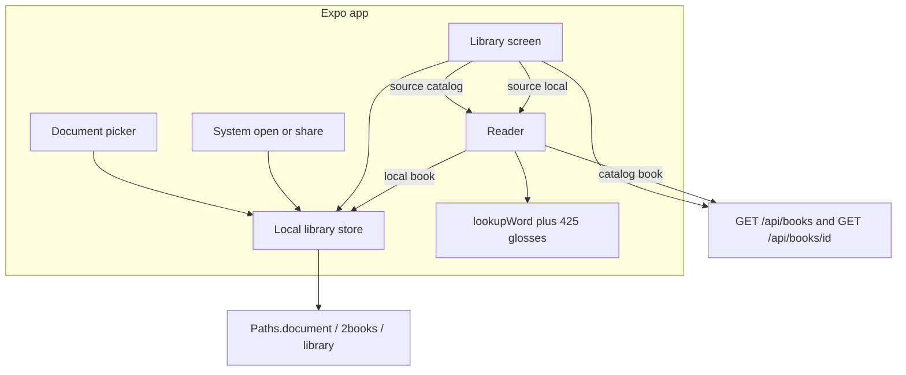
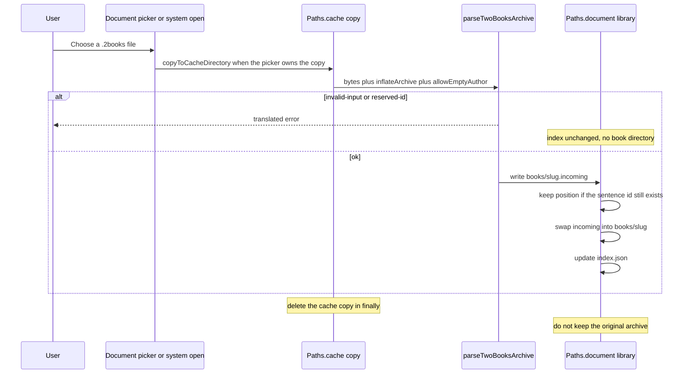
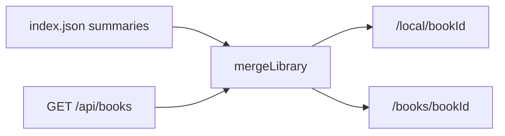

# On-device .2books import for the Expo reader

|        |                                                                                            |
| ------ | ------------------------------------------------------------------------------------------ |
| Author | TBD                                                                                        |
| Date   | 2026-11-08                                                                                 |
| Status | Draft                                                                                      |
| Scope  | `apps/mobile` plus a parser seam in `src/library`. No server, no D1, no public API change. |

## Overview

The phone app today is a catalog reader. `apps/mobile/lib/api.ts` loads `GET /api/books` and `GET /api/books/$bookId`, and `apps/mobile/app/books/[bookId].tsx` fetches the chosen book on every open. There is no account, no file import, and no offline book.

This slice lets a person add a `.2books` archive from the phone and read it with the network off. The archive is parsed with the same rules as `parseTwoBooks` in `src/library/two-books.ts`, then discarded. The parsed book is stored in the app documents directory, one chapter file at a time. The library list shows those local books beside the public catalog. If the catalog request fails, the local books stay on screen with a retry for the catalog only.

The reader follows the website in `src/reader/reader-screen.tsx`: one sentence selected, highlight as background plus underline, translation under the sentence on a phone and in a second column from 1024px, word lookup only while the sentence is open. Lookup uses the existing 425-lemma Gift of the Magi glossary (`src/dictionary/glossary.ts`). It does not grow into a general dictionary. Most words in an imported book will miss.

Nothing in this slice uploads the file, writes `catalog_books` or `user_books`, or calls the admin import in `src/admin/dashboard.server.ts`.

## Background & Motivation

`parseTwoBooks` already accepts the archive the admin importer publishes: a zip (methods 0 and 8), optional 64-byte prefix before `PK\x03\x04`, `meta.json`, `toc.json`, and `pages/N.json.gz`. Limits live in the unexported `importLimits`: archive 25_000_000 bytes, 200 chapters, 20_000 sentences, sentence 8_000, title 200, id 80, chapter JSON 900_000. Encrypted entries and zip64 are rejected. The public id is `meta.slug`, not the filename. `gift-of-the-magi` returns `{ ok: false, error: "reserved-id" }`. English is required. The secondary language is Ukrainian or Russian and is stored only in that field. The other translation field stays `""`. A missing secondary title is replaced with the English title. `paragraph` is optional on each sentence.

That function cannot run as-is on this app. `inflate` in `src/library/two-books.ts` is:

```ts
const stream = new Blob([copy]).stream().pipeThrough(new DecompressionStream(format));
return new Uint8Array(await new Response(stream).arrayBuffer());
```

`apps/mobile/package.json` pins `react-native` 0.88.1 and `expo` ~58.0.23. A search of `apps/mobile/node_modules/react-native` and `apps/mobile/node_modules/expo/src` finds no `DecompressionStream` runtime. The only declarations are TypeScript DOM libs. Expo's winter runtime installs `TextDecoder` and `TextDecoderStream`. It does not install Compression Streams. Hermes on this React Native version therefore cannot inflate method 8 or gunzip `.json.gz` with the web helper. `TextDecoder`, which the parser uses for zip names and JSON, is available.

The phone reader also does not match the website yet. `apps/mobile/app/books/[bookId].tsx` docks the translation in a bottom panel, does not split a selected sentence into words, does not fall back from an empty `uk` string to `ru` (or the reverse), and has no wide layout. `src/reader/reader-screen.tsx` already does those things. Tailwind `lg` on that screen is the 1024px breakpoint.

`apps/mobile/metro.config.js` is the default Expo config. It does not watch the repo `src/` tree and it does not honor the root package `#/*` import map. `apps/mobile/tsconfig.json` only maps `@/*` onto the Expo app. Importing `src/reader/reader-screen.tsx` or `src/library/books.server.ts` from Metro would pull TanStack, the DOM, and the D1 server. The shared surface has to be an allow-list of modules that import nothing from that graph.

Settings stay the two fields in `apps/mobile/lib/settings.tsx` (`interfaceLocale`, `nativeLanguage`, SecureStore key `2books.settings`). The web reading font, size, and paper preferences are out of scope.

## Goals & Non-Goals

### Goals

- Add a `.2books` file from inside the app with `expo-document-picker`, and also open one from the Android share sheet or the iOS Files app / share sheet. Both platforms are in this version. The system path needs a prebuild, not a hand-written native fork.
- Parse with the same acceptance rules as `parseTwoBooks`. Invalid, encrypted, zip64, oversize, and reserved-id files fail with a translated message and are not stored.
- Allow an empty author on the local path only. Show the title anyway.
- Keep the parsed book on device so the next open does not touch the network. Do not keep the original archive after a successful parse.
- Re-import of the same slug replaces that local book and keeps the reading position when the sentence id still exists.
- Merge server summaries and local summaries on the library screen. A failed catalog request must not hide local books.
- Distinguish a local book from a catalog book that happens to use the same slug, in the list and in navigation.
- Render one chapter at a time. A long import can be thousands of sentences. A local book loads one chapter file. A catalog book keeps the fetched payload, because the phone has no second request, and the reader still shows one chapter.
- Save reading position on the device for imported books only. Do not add server progress, and do not add catalog progress on the phone.
- Delete a local book, its chapter files, and its position from the library. Never delete a catalog book.
- Interface language stays `uk` | `ru` | `en`, independent of the book's translation language. Native language stays `uk` | `ru`. New strings exist in all three catalogs in `apps/mobile/lib/messages.ts`.
- Unit-test the parser boundary and the library merge with synthetic books.

### Non-goals

- Google sign-in, accounts, uploading the file, admin catalog import, writing `catalog_books` or `user_books`.
- Machine translation, Anki, audio.
- Web font, size, and paper preferences.
- Enabling shadcn lint rules, deploy, or a public API change. `GET /api/books` and `GET /api/books/$bookId` keep their JSON shape.
- A general dictionary. No invented glosses.
- Rewriting the root README. `apps/mobile/README.md` may gain two sentences on how to run the app. It already says the app does not sign in or upload.
- Claiming an iOS install was executed. This machine is Linux.

## Proposed Design

### Architecture



Catalog books keep today's network fetch. Local books never call `fetchBooks` or `fetchBook`. The admin import in `importCatalogFile` (`src/admin/dashboard.server.ts`) is not referenced from `apps/mobile`.

### Parser boundary and decompression

Split the pure parser out of the web inflater. `src/library/two-books.ts` keeps the public function the tests and the admin importer already call. A new sibling holds the zip and book logic and takes the inflater as an argument.

```ts
export type TwoBooksInflate = (
  bytes: Uint8Array,
  format: "deflate-raw" | "gzip",
) => Promise<Uint8Array>;

export type ParseTwoBooksOptions = {
  /** Default false. The web and admin callers leave this off. */
  allowEmptyAuthor?: boolean;
};

export async function parseTwoBooksArchive(
  bytes: Uint8Array,
  inflate: TwoBooksInflate,
  options: ParseTwoBooksOptions = {},
): Promise<
  { ok: true; book: TwoBooksCatalog } | { ok: false; error: "invalid-input" | "reserved-id" }
>;
```

`src/library/two-books.ts` becomes a thin wrapper. Existing callers, including `importCatalogFile` and `src/library/two-books.test.ts`, stay on one argument:

```ts
async function inflateWeb(bytes: Uint8Array, format: "deflate-raw" | "gzip"): Promise<Uint8Array> {
  const copy = new Uint8Array(bytes.byteLength);
  copy.set(bytes);
  const stream = new Blob([copy]).stream().pipeThrough(new DecompressionStream(format));
  return new Uint8Array(await new Response(stream).arrayBuffer());
}

export async function parseTwoBooks(bytes: Uint8Array) {
  return parseTwoBooksArchive(bytes, inflateWeb);
}

export type {
  TwoBooksCatalog,
  TwoBooksSentence,
  TwoBooksInflate,
  ParseTwoBooksOptions,
} from "./two-books-parse";
export { parseTwoBooksArchive } from "./two-books-parse";
```

`src/library/books.server.ts` imports `type { TwoBooksCatalog } from "#/library/two-books"`. Those re-exports keep that import compiling after the types move into `two-books-parse.ts`. `TwoBooksSentence` is exported from `two-books.ts` today and stays exported. Callers, including `importCatalogFile` and `src/library/two-books.test.ts`, stay on `#/library/two-books`. Metro does not import `two-books.ts`. It imports `two-books-parse.ts` only.

`allowEmptyAuthor` defaults to false inside `parseTwoBooksArchive`, so an empty author is still `invalid-input` for the web and for D1 import. That matters: `insertImportedCatalogBook` would store `author: ""`, and `parseChapterMeta` in `src/library/books.server.ts` then drops the row because `parsed.author.trim() === ""`. Changing the default would make an admin import succeed and then vanish. The phone opts in. Empty English or secondary title is still `invalid-input` on both paths.

The phone inflater lives in `apps/mobile/lib/inflate-archive.ts` and is the only place that touches `fflate`. Add `fflate` `0.8.3`, or a later `0.8.x`, to `apps/mobile` dependencies. It is pure JavaScript, has no config plugin, and works in Expo Go. The import is only `inflateSync` and `gunzipSync`. `inflateSync` is raw DEFLATE, which is zip method 8. `gunzipSync` is the gzip wrapper on `pages/N.json.gz`. Method 0 does not call inflate. Do not import `unzip` or `unzipSync`. Versions below `0.8.3` have a denial-of-service in `unzipSync` on a malformed ZIP64 central directory. This parser does not call that function, because `readCentralDirectory` already rejects zip64, and the dependency is still `0.8.3` or later `0.8.x` so the app is not frozen on that release. `fflate` is not a root dependency and is not added to the Cloudflare worker bundle.

```ts
import { gunzipSync, inflateSync } from "fflate";
import type { TwoBooksInflate } from "../../../src/library/two-books-parse";

export const inflateArchive: TwoBooksInflate = async (bytes, format) => {
  const copy =
    bytes.byteOffset === 0 && bytes.byteLength === bytes.buffer.byteLength
      ? bytes
      : Uint8Array.from(bytes);
  return format === "gzip" ? gunzipSync(copy) : inflateSync(copy);
};
```

`readEntry` already turns a thrown inflate into a null entry and then `invalid-input`. A corrupt deflate stream fails the same way on both runtimes.

Do not import `src/library/two-books.ts` from Metro. That file mentions `DecompressionStream`. The allow-list below names `two-books-parse.ts` only.

`fflate` is not added to the Cloudflare worker. The worker keeps `DecompressionStream`, which `worker-configuration.d.ts` already declares.

### What Metro may import

`apps/mobile/metro.config.js` watches the repo folders that hold the allow-list and blocks every other file under `src/`. Default `blockList` entries from `getDefaultConfig` stay. The extra pattern is anchored at the repo `src` directory so `node_modules` is untouched.

Allowed files, after one import edit:

| Module                           | Why it is safe                                                                                                                                                           |
| -------------------------------- | ------------------------------------------------------------------------------------------------------------------------------------------------------------------------ |
| `src/library/two-books-parse.ts` | No imports. `TextDecoder`, `Uint8Array`, `JSON` only.                                                                                                                    |
| `src/dictionary/glossary.ts`     | No imports. 425 lemmas, `uk` and `ru` only.                                                                                                                              |
| `src/dictionary/lookup.ts`       | Today imports `#/dictionary/glossary` and `#/i18n/types`. Change those two lines to `./glossary` and `../i18n/types`. Vite still loads it through `#/dictionary/lookup`. |
| `src/i18n/types.ts`              | `Locale` and `NativeLanguage` only. No imports.                                                                                                                          |
| `src/reader/selection.ts`        | `selectSentence`, `selectWord`, `clearSelection`. No imports.                                                                                                            |

Not allowed: `src/reader/reader-screen.tsx`, `src/library/two-books.ts`, `src/library/books.server.ts`, `src/content/**`, anything that imports `#/`.

`lookup.ts` relative imports do not change gloss behavior. `src/dictionary/lookup.test.ts` keeps importing `#/dictionary/lookup`. Do not copy the glossary into `apps/mobile`. Do not add lemmas.

### On-disk layout

Use `Paths.document` from `expo-file-system` 58.0.13 (`File`, `Directory`, `Paths`). That directory is not cleared when the OS reclaims cache. `Paths.cache` is only the temporary copy `expo-document-picker` makes while parsing.

`expo-file-system` is already unpacked under `apps/mobile/node_modules` as a transitive copy. It is not in `apps/mobile/package.json`. Add it directly at `~58.0.13` so the app owns the API. Use the current `File` / `Directory` / `Paths` entry, not `expo-file-system/legacy`.

```
Paths.document/2books/library/
  index.json
  books/<slug>/
    book.json
    position.json          # absent until the first selection or chapter change
    chapters/<chapterId>.json
  books/<slug>.incoming/   # crash window only
  books/<slug>.previous/   # crash window only
```

`<slug>` is `meta.slug` after `parseTwoBooksArchive`. The parser already requires `^[a-z0-9]+(?:-[a-z0-9]+)*$` and length at most 80, so the segment cannot be `.`, `..`, or a path. Before joining any route param onto this tree, run that same pattern and nothing else. If it fails, show the load error and do not touch the filesystem. `gift-of-the-magi` matches the pattern (length 17). The path guard accepts it. The parser is the only reserved-id gate and never writes that directory, so `/local/gift-of-the-magi` is a missing book. It does not shadow `/books/gift-of-the-magi`. `../x` fails the pattern and is rejected before any join.

`index.json` is the library list. It does not contain sentences.

```ts
type LocalIndex = {
  version: 1;
  books: {
    id: string;
    author: string;
    title: { uk: string; ru: string; en: string };
    chapterCount: number;
    importedAt: number;
  }[];
};
```

`book.json` is the chapter list without sentences:

```ts
type StoredLocalBook = {
  version: 1;
  id: string;
  author: string;
  title: { uk: string; ru: string; en: string };
  importedAt: number;
  chapters: {
    id: string;
    title: { uk: string; ru: string; en: string };
    sentenceCount: number;
  }[];
};
```

`importedAt` on `book.json` is the same number stored in the index, so startup can refresh the index from the book file. A `book.json` from an older build of this slice may omit the field.

Each `chapters/cN.json` is one parser chapter, including `paragraph` when the parser set it, and including the empty translation field. Do not copy `uk` into `ru` or the reverse at write time. A missing title slot is already the English title when it leaves the parser. Leave that as the parser wrote it.

`position.json`:

```ts
type LocalPosition = { chapterId: string; sentenceId: string | null };
```

Worst case inside the existing limits is 200 chapter files and a chapter JSON of 900_000 characters. That is why the reader loads one chapter file. The import itself still holds one parsed book in memory, because `parseTwoBooksArchive` returns the whole catalog. That peak is import-only. After the files are written, drop the object.

An unknown `version` in `index.json` is left on disk and treated as no local books. Do not delete it. Do not list `books/`, and do not write `index.json`. A downgrade must not rewrite a future index as version 1.

Crash recovery runs only when `version === 1`, or when `index.json` is missing, which is an empty version-1 library. `Directory.list()` on `books/` returns every child (`expo-file-system` 58.0.13, `list(): (Directory | File)[]`). Do not keep only names that already match the slug pattern. After replace step 5 the live directory is gone, and the only children are `<slug>.incoming` and `<slug>.previous`. Both contain a dot, so a pattern-first scan would skip the crash it is meant to repair.

Derive candidates from that full list:

- If a child name ends with `.incoming`, the candidate is that name with that one suffix removed.
- Otherwise, if it ends with `.previous`, the candidate is that name with that one suffix removed.
- Otherwise the candidate is the child name.
- Strip one suffix only. `red-boat.incoming.previous` becomes `red-boat.incoming`, which then fails the slug pattern and is ignored. It is not stripped twice into `red-boat`.
- Keep the candidate only when it matches `^[a-z0-9]+(?:-[a-z0-9]+)*$` and is at most 80 characters. A slug is in the set when any of the live directory, `.incoming`, or `.previous` exists, including when the live directory is absent.

Apply directory rules to that set first, before any index write:

- `<slug>.incoming` exists, `<slug>` is missing, and `<slug>.previous` exists: move `.previous` to `<slug>` with `{ overwrite: true }`, then delete `.incoming`. This is the step-5 crash. The previous book comes back, and the unfinished incoming tree is removed.
- `<slug>` exists and `.incoming` exists: delete `.incoming`. If `.previous` also exists, delete `.previous`.
- `<slug>` exists, `.incoming` is already gone, and `.previous` exists: delete `.previous`.

Then refresh and drop index entries. These two walks are not limited to directory names that matched before the suffix strip:

- For each kept slug, if `books/<slug>/book.json` is present after the moves above, replace that index entry from `book.json` even when the id is already listed. Copy `id`, `author`, `title`, `chapterCount` (`chapters.length`), and `importedAt`. If an older `book.json` has no `importedAt` and the id is already listed, keep the index `importedAt`. If the id is new and `importedAt` is absent, store `0` so the row sorts last instead of moving to the front on every launch. Do not refresh from `.incoming/book.json` or `.previous/book.json`.
- Separately, walk every index entry. If `books/<slug>/book.json` is missing after the moves, drop the entry. This includes an id whose directory is gone entirely, which a scan of child names cannot see. It does not drop the step-5 book, because that book was restored to `<slug>` before this walk.

Write `index.json` by writing `index.json.tmp` in the same directory, then `tmp.move(indexFile, { overwrite: true })`. In the installed `expo-file-system` 58.0.13, `File.move` and `Directory.move` take `RelocationOptions`, and `overwrite` defaults to false (`src/File.types.ts`). Without it, the move throws `DestinationAlreadyExists` once `index.json` exists. `rename()` does not take `overwrite`. Every directory move in replace and in recovery uses `{ overwrite: true }` or deletes the destination first.

### Import flow



`DocumentPicker.getDocumentAsync` (`expo-document-picker` ~58.0.4, the version in `expo/bundledNativeModules.json` for SDK 58):

```ts
await DocumentPicker.getDocumentAsync({
  copyToCacheDirectory: true,
  multiple: false,
  type: "*/*",
});
```

`copyToCacheDirectory: true` is required. With it false, `expo-file-system` cannot read an Android `content://` URI (Expo issue 30342, and the SDK 58 document-picker page). `*/*` is deliberate. A custom MIME filter hides the file in Expo Go, where `com.twobooks.book` is not registered, and on Android file managers that label the archive `application/octet-stream`. The name and the parser do the filtering.

Name rule, before reading more than `asset.size`:

- The document picker's `asset.size` is a finite number greater than 25_000_000: `invalid-input`, do not read the body. The parser checks the byte length again. This field is the picker result, not `File.size`. A share has no picker asset. Do not call `File.size` on any import URI. On Android, `File.size` for a `content://` URI calls `ContentProviderFile.length()`, which reads the entire stream when `OpenableColumns.SIZE` is missing.
- `name` ends with `.2books` in any case, or `name` has no `.`, or `name` is missing: parse.
- `name` has some other extension: `invalid-input`, do not parse. A random PDF should not go through inflate.

`File.bytes()` in the installed `expo-file-system` 58.0.13 takes no length (`NativeFileSystem.types.ts`). Android reads the whole stream (`inputStream().readBytes()`) and iOS uses `Data(contentsOf:)`, so it cannot enforce the cap. Read with a `FileHandle` and stop after 25_000_001 bytes. `file.open(FileMode.ReadOnly)` returns the handle (`open(mode?: FileMode): FileHandle`). `readBytes(length)` returns a shorter array at EOF and an empty array when the offset is already at the end. The offset advances by the bytes actually read. Always `handle.close()` in `finally`. An open handle can block a later delete or move. On iOS, `FileSystemFileHandle` calls `startAccessingSecurityScopedResource()` when the handle opens, and `close()` stops that access, so the read still happens immediately in the import handler.

The in-app picker passes a `file://` URI. `copyToCacheDirectory: true` copies the chosen document into `Paths.cache` before this read, and that cache file keeps the capped loop.

A share is not that path. `sharedPayloads[].value` for `shareType: "file"`, and a VIEW `content:` URL, can be a `content://` URI. This install classifies a non-SAF `content://` URI as `ContentProviderFile` (`android/.../unifiedfile/ContentProviderFile.kt`). That class says share-intent URIs may or may not support random access. `FileSystemFile.openHandle` catches the failure and throws `IllegalStateException`, and the message tells the caller to use `File.bytes()` instead. Do not follow that message.

If `open` throws, return `"unreadable"`. That is `importInvalid`. Do not call `File.bytes()`, `File.text()`, or `File.size`. Do not parse, and do not create `<slug>.incoming`. A provider that does support `openFileDescriptor` still uses the capped loop below. A provider that does not is rejected even when the bytes would have been a valid archive. An uncapped fallback would read the stream with no 25_000_001 stop.

```ts
import { File, FileMode } from "expo-file-system";

const ARCHIVE_LIMIT = 25_000_000;

async function readArchiveBounded(uri: string): Promise<Uint8Array | "oversize" | "unreadable"> {
  let handle;
  try {
    handle = new File(uri).open(FileMode.ReadOnly);
  } catch {
    return "unreadable";
  }
  try {
    const chunks: Uint8Array[] = [];
    let total = 0;
    const stop = ARCHIVE_LIMIT + 1;
    while (total < stop) {
      const chunk = await handle.readBytes(Math.min(1024 * 1024, stop - total));
      if (chunk.byteLength === 0) break;
      chunks.push(chunk);
      total += chunk.byteLength;
    }
    if (total > ARCHIVE_LIMIT) return "oversize";
    const out = new Uint8Array(total);
    let offset = 0;
    for (const chunk of chunks) {
      out.set(chunk, offset);
      offset += chunk.byteLength;
    }
    return out;
  } finally {
    handle.close();
  }
}
```

`"oversize"` and `"unreadable"` are `invalid-input`. Do not parse those bytes. The picker `asset.size` greater than 25_000_000 still skips the read. The handle loop is the cap when that field is missing or lies, and it is the only read a `file://` cache URI uses. Then `parseTwoBooksArchive(bytes, inflateArchive, { allowEmptyAuthor: true })`.

On `invalid-input` or `reserved-id`, delete any `<slug>.incoming` directory if one was started, delete the cache copy, leave `index.json` and any existing `books/<slug>` alone. A failed re-import must not destroy the book that is already on the phone.

On success, delete the cache copy in `finally` only when the URI is under `Paths.cache`. A security-scoped Files URL is not ours. Do not delete the user's original. A URI outside `Paths.cache` is never passed to `delete`.

The import button is disabled while a parse is in flight. That disabled state is only the UI. The rule is a promise-chain mutex shared by the picker and by the incoming-file drain. A second import, including a share that arrives mid-parse, waits on that chain. It is not dropped, and it does not run beside the first one.

### Replace on the same slug

1. Parse to completion first. On failure, stop. Choose `importedAt = Date.now()` before any rename.
2. Read the existing `position.json` if `books/<slug>/` exists.
3. Write the new tree to `books/<slug>.incoming/`, including chapter files and `book.json`. `book.json` stores that same `importedAt`.
4. If the saved `sentenceId` is a non-empty string and some new chapter contains that id, write `position.json` into `.incoming` with that chapter's id and that sentence id. If the id is missing, omit `position.json`.
5. If `books/<slug>.previous/` exists, delete it. Then, if `books/<slug>/` exists, move it to `books/<slug>.previous/` with `{ overwrite: true }`. A leftover `.previous` would otherwise throw `DestinationAlreadyExists` after a successful parse, and the user would see `importFailed` while the new tree sits in `.incoming`.
6. Move `.incoming` to `books/<slug>/` with `{ overwrite: true }`.
7. Delete `.previous`.
8. Upsert the index summary with the `importedAt` chosen in step 1.

Sentence ids from the parser are `s1`, `s2`, … in reading order. They are not content hashes. A re-import that still has `s12` keeps the position even if the English text at `s12` changed. That is the requested rule. The risk is recorded below.

There is no extra confirm on replace. The person picked the file. A failed parse does not replace.

### Route and list identity

A local slug may equal a catalog id that is not reserved. `gift-of-the-magi` never gets that far: the parser returns `reserved-id` and nothing is stored. Any other clash stays visible as two rows.

|          | Catalog                    | Local                             |
| -------- | -------------------------- | --------------------------------- |
| List key | `catalog:${id}`            | `local:${id}`                     |
| Route    | `/books/[bookId]` as today | `/local/[bookId]`                 |
| Open     | `fetchBook(id)`            | `book.json` plus one chapter file |
| Delete   | none                       | library action only               |
| Progress | none, as today             | `position.json`                   |

`/books/red-boat` is always the network catalog, even when `books/red-boat/` exists on disk. A catalog 404 does not fall through to the local file. `/local/red-boat` is always the file. Putting `local:` inside the existing `[bookId]` param would make a bug call `fetchBook("local:red-boat")`. A separate route makes that a different screen.

```ts
type LibraryRow =
  | { source: "catalog"; key: `catalog:${string}`; book: BookSummary }
  | { source: "local"; key: `local:${string}`; book: BookSummary };
```

`BookSummary` is the existing mobile type. Local rows use `chapterCount` from the index. Order on screen: import control, catalog error banner if needed, local rows newest `importedAt` first, then catalog rows in server order. Each local card shows the "on this phone" label. The author line is omitted when `author.trim() === ""`. The title still shows, using `title[interfaceLocale]`, then `title.en`, then the first non-empty title.



`mergeLibrary` is a pure function in `apps/mobile/lib/library-merge.ts` with no React Native import, so `bun test` can run it:

```ts
export function mergeLibrary(
  catalog: BookSummary[] | null,
  local: BookSummary[],
): { rows: LibraryRow[]; catalog: "ready" | "missing" } {
  const localRows = local.map((book) => ({
    source: "local" as const,
    key: `local:${book.id}` as const,
    book,
  }));
  if (catalog === null) return { rows: localRows, catalog: "missing" };
  return {
    catalog: "ready",
    rows: [
      ...localRows,
      ...catalog.map((book) => ({
        source: "catalog" as const,
        key: `catalog:${book.id}` as const,
        book,
      })),
    ],
  };
}
```

The library screen in `apps/mobile/app/index.tsx` stops using a single `books === null` branch that replaces the list with `ScreenState`. Local index state and catalog state are separate.

- Local index not read yet: the existing loading state. This is disk, not the network.
- Local index ready, catalog in flight: local rows plus a compact loading row. Do not hide local rows.
- Catalog failed: banner `catalogUnavailable`, the existing retry button, local rows still listed. Retry refetches only the catalog. It must not clear local state.
- Catalog succeeded and both lists are empty: `emptyCatalog`, import button still visible.
- Catalog succeeded and only one side has books: show that side. Do not show `emptyCatalog`.

Opening a catalog row stays `router.push({ pathname: "/books/[bookId]", params: { bookId } })`. Opening a local row pushes `/local/[bookId]`.

### Reader

One presentational component, `apps/mobile/components/reader.tsx`, used by `app/books/[bookId].tsx` and `app/local/[bookId].tsx`. The screens own loading. The component owns selection, layout, and glosses.

Catalog screen: keep `fetchBook`. The public payload still contains every chapter, and `GET /api/books/$bookId` does not change. Unlike the website, the phone has no second request. `chapterView` in `src/library/chapter-view.ts` only runs inside `loadReaderChapter` on the server. Do not import that file. It imports `#/content/catalog`.

Keep the fetched `BookDetail` intact in a ref or in state. Do not overwrite it with empty `sentences` arrays. Pass `apps/mobile/components/reader.tsx` a derived view: every chapter keeps its `id` and `title`, and only the open index keeps its sentences. Changing chapter changes the open index and builds a new view from the same `BookDetail`. Previous, next, and the part chips still read titles from that object. This does not shrink the network payload. The full JSON still arrives once and stays in memory on the catalog screen, because that is the only copy. The reader renders one chapter.

```ts
function chapterView(book: BookDetail, openIndex: number): BookDetail {
  return {
    ...book,
    chapters: book.chapters.map((chapter, index) =>
      index === openIndex ? chapter : { ...chapter, sentences: [] },
    ),
  };
}
```

The helper returns a new object. It does not mutate `book`.

Local screen: read `book.json`, then only `chapters/<id>.json` for the open chapter. No `fetch`. The other chapters' sentences are never loaded. Restoring `position.json` picks the chapter file and, when `sentenceId` is in that chapter, selects it with no word index. If the position chapter is missing, open chapter 0 and delete the bad position file.

Selection uses `selectSentence`, `selectWord`, and `clearSelection` from `src/reader/selection.ts`.

- One sentence. Tap selects. Tap the same sentence again, or the dismiss control, clears it.
- Changing chapter clears the selection.
- Unselected sentence: one `Pressable` whose visible text is `sentence.en` with no trim and no added spaces. Do not put newlines or extra spaces inside the `Text` children. The accessibility label may use the existing `sentenceLabel` when the trimmed string is empty, matching the current screen.
- Selected sentence: not an outer `Pressable` wrapping word `Pressable`s. A `View` with `backgroundColor: colors.accentSoft` and underline on the text. Words are nested pressables. Whitespace tokens stay their own `Text` nodes. Tokenization is the website's, not a new splitter:

```ts
type SentenceToken = { kind: "word"; index: number; text: string } | { kind: "gap"; text: string };

function sentenceTokens(text: string): SentenceToken[] {
  const tokens: SentenceToken[] = [];
  let wordIndex = 0;
  for (const match of text.matchAll(/\s+|\S+/g)) {
    const value = match[0];
    if (value.trim() === "") tokens.push({ kind: "gap", text: value });
    else {
      tokens.push({ kind: "word", index: wordIndex, text: value });
      wordIndex += 1;
    }
  }
  return tokens;
}
```

- Word presses only exist while the sentence is selected. `selectWord` on the same index clears `wordIndex` and leaves `selectedId`. The gloss row hides. The translation stays.
- Gloss: `lookupWord(token.text, nativeLanguage)` from `src/dictionary/lookup.ts`. The string is in the native language, not the interface language. `null` shows `noDictionaryEntry` in the interface language. The glossary is the 425 lemmas in `src/dictionary/glossary.ts`, written for The Gift of the Magi. An imported novel will miss almost every word. Do not ship another word list and do not synthesize a translation.
- Narrow width (`useWindowDimensions().width < 1024`): unselected translation is not rendered. The selected translation is a block under that sentence, inside the scroll, not the docked panel the screen uses today. Dismiss sits under that block. The hint shows under the chapter when nothing is selected, and hides while a sentence is open.
- Wide width (`>= 1024`, the website's `lg`): each sentence is a row, English on the left, native on the right, both visible for every sentence. Headers use `textEnglish` and either `textUkrainian` or `textRussian` from the strings below. Dismiss is not rendered. The hint is not rendered.
- Translation text, render time only, same rule as `nativeLine` in `src/reader/reader-screen.tsx`:

```ts
function nativeLine(sentence: Sentence, native: NativeLanguage, locale: Locale): string {
  if (sentence[native] !== "") return sentence[native];
  const other = native === "uk" ? sentence.ru : sentence.uk;
  if (other !== "") return other;
  return message(locale, "noTranslation");
}
```

Empty means `""`, not trim. Do not write the fallback back into the chapter file.

Group sentences by `paragraph` the way `paragraphGroups` does. A missing or invalid paragraph is 0. Groups are vertical stacks of sentence rows. This is not a single inline paragraph that reflows the translation into the English line.

Chapter chrome that already exists stays: part chips, previous, next. Chip label is the chapter title in the interface locale. The catalog client today sets `title` to `""` when the API sends a locale object (`parseChapter` in `apps/mobile/lib/api.ts`). The API already sends `{ uk, ru, en }` and must keep doing so. Teach the client parser to accept either a string or that object, and store a `BookTitle` on the chapter. A string title is copied into all three locales. Display `title[locale]`, then `title.en`, then `partLabel`. That is a client fix. It is not a route change.

Local position writes: on sentence select, on clear, and on chapter change, write `position.json` with the open `chapterId` and the selected sentence id or `null`. Catalog screens do not write it. There is no account progress in this slice. The phone does not save catalog progress today, and this design does not add it.

Author: if `book.author.trim() === ""`, render no author line. The title still renders. The website already does this (`book.author ? ... : null` in `reader-screen.tsx`). The current phone screen always renders the author `Text`.

Delete sits on the local library card, not on catalog cards. Confirm with `Alert.alert`. Confirm deletes `books/<slug>/` (chapter files and `position.json` together) and the index entry. It does not call the network.

### File-type registration

In-app pick works in Expo Go. `expo-document-picker` ~58.0.4 is marked included in Expo Go, and it does not need the UTI to exist.

Opening from the system does not work in Expo Go. Info.plist and `AndroidManifest.xml` changes apply only after prebuild. That is `npx expo run:android` on this machine when an emulator or device is attached. It is a generated native project, not a fork of Expo or React Native. No new Kotlin or Swift module is written. `expo-dev-client` is not required for that command. The existing `bun run start` / `bun run android` scripts keep launching Expo Go for the picker path.

Packages, all from `apps/mobile/node_modules/expo/bundledNativeModules.json` for Expo 58.0.23:

| Package                | Version                  | Role                                                                                                                        |
| ---------------------- | ------------------------ | --------------------------------------------------------------------------------------------------------------------------- |
| `expo-document-picker` | `~58.0.4`                | In-app picker. Expo Go.                                                                                                     |
| `expo-file-system`     | `~58.0.13`               | `Paths.document`, `Paths.cache`, `File.open(FileMode.ReadOnly)`, `FileHandle.readBytes`, `move` with `{ overwrite: true }`. |
| `expo-sharing`         | `~58.0.22`               | Receive a share. Config plugin adds the Android SEND filter and the iOS share extension.                                    |
| `fflate`               | `0.8.3` or later `0.8.x` | `inflateSync` and `gunzipSync` only. No plugin. Not a root dependency.                                                      |

`app.json` changes. Existing `scheme`, bundle id `com.twobooks.reader`, cleartext, and the current plugins stay.

```json
{
  "ios": {
    "infoPlist": {
      "NSAppTransportSecurity": { "NSAllowsLocalNetworking": true },
      "UTExportedTypeDeclarations": [
        {
          "UTTypeIdentifier": "com.twobooks.book",
          "UTTypeDescription": "2books book",
          "UTTypeConformsTo": ["public.data", "public.archive"],
          "UTTypeTagSpecification": {
            "public.filename-extension": ["2books"],
            "public.mime-type": ["application/vnd.twobooks.book"]
          }
        }
      ],
      "CFBundleDocumentTypes": [
        {
          "CFBundleTypeName": "2books book",
          "CFBundleTypeRole": "Viewer",
          "LSHandlerRank": "Owner",
          "LSItemContentTypes": ["com.twobooks.book"]
        }
      ]
    }
  },
  "android": {
    "intentFilters": [
      {
        "action": "VIEW",
        "category": ["DEFAULT", "BROWSABLE"],
        "data": [
          { "scheme": "content", "mimeType": "application/vnd.twobooks.book", "host": "*" },
          { "scheme": "file", "mimeType": "application/vnd.twobooks.book", "host": "*" }
        ]
      },
      {
        "action": "VIEW",
        "category": ["DEFAULT", "BROWSABLE"],
        "data": [
          { "scheme": "content", "mimeType": "*/*", "host": "*", "pathPattern": ".*\\.2books" },
          {
            "scheme": "content",
            "mimeType": "*/*",
            "host": "*",
            "pathPattern": ".*\\..*\\.2books"
          },
          {
            "scheme": "content",
            "mimeType": "*/*",
            "host": "*",
            "pathPattern": ".*\\..*\\..*\\.2books"
          },
          {
            "scheme": "content",
            "mimeType": "*/*",
            "host": "*",
            "pathPattern": ".*\\..*\\..*\\..*\\.2books"
          },
          { "scheme": "file", "mimeType": "*/*", "host": "*", "pathPattern": ".*\\.2books" },
          { "scheme": "file", "mimeType": "*/*", "host": "*", "pathPattern": ".*\\..*\\.2books" },
          {
            "scheme": "file",
            "mimeType": "*/*",
            "host": "*",
            "pathPattern": ".*\\..*\\..*\\.2books"
          },
          {
            "scheme": "file",
            "mimeType": "*/*",
            "host": "*",
            "pathPattern": ".*\\..*\\..*\\..*\\.2books"
          }
        ]
      }
    ]
  },
  "plugins": [
    "expo-router",
    "expo-secure-store",
    ["expo-file-system", { "supportsOpeningDocumentsInPlace": true, "enableFileSharing": false }],
    [
      "expo-sharing",
      {
        "ios": { "enabled": true, "activationRule": { "supportsFileWithMaxCount": 1 } },
        "android": {
          "enabled": true,
          "singleShareMimeTypes": [
            "application/vnd.twobooks.book",
            "application/zip",
            "application/octet-stream"
          ]
        }
      }
    ]
  ]
}
```

Android details, from `@expo/config-plugins/build/android/IntentFilters.js` in this install. Each `intentFilters` entry becomes one `<intent-filter>`, and every `data` object becomes a sibling `<data>`. Android ORs those siblings, so MIME and path must not share a filter with unrelated schemes. The two VIEW filters above are separate on purpose. `pathPattern` is passed through as `android:pathPattern`. Android's `.*` does not cross extra dots reliably, so the three extra patterns are the usual workaround. SEND is not also declared here. `expo-sharing`'s plugin owns `ACTION_SEND`. `LinkingReactActivityLifecycleListener` in this install only reads `intent.data`, not `EXTRA_STREAM`, so a hand-rolled SEND filter would not deliver the file to JS.

`supportsOpeningDocumentsInPlace: true` writes `LSSupportsOpeningDocumentsInPlace`. `enableFileSharing: false` writes `UIFileSharingEnabled` to false. The installed plugin (`apps/mobile/node_modules/expo-file-system/plugin/src/withFileSystem.ts`) writes that key whenever `'enableFileSharing' in options`. It does not omit the key. False and an absent key are equivalent for the iOS Files browser: the documents directory is not shared. Do not turn on `ios.usesIcloudStorage`. The system document picker already shows iCloud Drive. The app does not need its own ubiquity container.

The same plugin always calls `AndroidConfig.Permissions.withPermissions` with `android.permission.READ_EXTERNAL_STORAGE`, `android.permission.WRITE_EXTERNAL_STORAGE`, and `android.permission.INTERNET`, even when the app only wants the iOS document flags. Prebuild will add those three permissions. That is a plugin side effect, not an accidental manifest edit, and it is broader than reading the one document the user just opened. Do not delete them in review as if they were a mistake. The iOS flags stay as written above.

Read the bytes immediately in the import handler, through `File.open(FileMode.ReadOnly)`. On iOS, `FileSystemFileHandle.init` calls `startAccessingSecurityScopedResource()`, and `close()` ends that access.

iOS share sheet: the SDK 58 `expo-sharing` plugin adds a share extension that opens the main app. Expo documents this as experimental and not a supported Apple share-extension UI. Use it anyway. It is the SDK mechanism, and it does not require a custom native target we maintain. `supportsFileWithMaxCount: 1` can offer the app for a generic file. The handler still rejects a bad name or a bad archive and stores nothing. Do not set image, movie, text, or web activation.

Incoming URLs:

- Android VIEW and iOS document open arrive as `content:` or `file:` URLs. `expo-linking`'s Android listener stores `intent.data`. On iOS, `ExpoAppSceneDelegate.scene(_:openURLContexts:)` forwards to the app delegate, and `LinkingAppDelegateSubscriber` stores the URL. Expo Router then tries to treat that URL as a route.
- Android SEND and the iOS share extension arrive through `expo-sharing`. For a file share, `useIncomingShare().sharedPayloads` (the same list as synchronous `getSharedPayloads()`) has `shareType: "file"` and `value` set to the file URI. That payload does not need the network. Do not call `getResolvedSharedPayloadsAsync`, and do not wait on `resolvedSharedPayloads`. The SDK documents that resolved call as experimental and says it may need the network to fetch URL-share headers. An offline share of a local file must still import. `originalName` exists only on the resolved payload. Use it for the extension check only when a resolved payload is already present without waiting. A missing name still parses, which is the existing name rule.

`apps/mobile/app/+native-intent.ts` intercepts before the router parses the URL. Side effect into a tiny module `apps/mobile/lib/incoming-file.ts` that holds the URI until the library screen takes it. Returning `/` keeps the person on the library, which already owns import.

```ts
export function redirectSystemPath({ path }: { path: string; initial: boolean }): string {
  try {
    if (new URL(path).hostname === "expo-sharing") return "/";
    const url = new URL(path);
    if (url.protocol === "file:" || url.protocol === "content:") {
      enqueueIncoming(path);
      return "/";
    }
  } catch {
    return path;
  }
  return path;
}
```

`incoming-file.ts` is a module queue, not a value read once on mount. `enqueueIncoming` appends the URI and notifies listeners. The URI stays pending until `takeIncoming` removes it. The library screen in `apps/mobile/app/index.tsx` stays mounted under the stack in `app/_layout.tsx`, so a mount-only effect does not see a later URL, and `redirectSystemPath` returning `"/"` does not remount it.

Wake-up, both of these:

- Subscribe for the screen's lifetime. A URI that arrives while the screen is already mounted, including while the reader is pushed on top, starts the drain immediately.
- Also drain inside `useFocusEffect` from `expo-router` whenever the library gains focus. That export is in `apps/mobile/node_modules/expo-router/build/exports.d.ts`. It covers a URI queued before the listener existed, and a warm "Open in" that landed while the screen was unfocused.

`useIncomingShare()` lives on that same mounted library screen. When `sharedPayloads` changes, copy each `shareType === "file"` `value` into the queue immediately. Call `clearSharedPayloads()` after that URI's bounded read finishes, whether the bytes were read, the read failed, or `File.open` threw `"unreadable"`. Do not clear before the URI is queued, and do not wait on network resolution before the clear. Clearing after the read stops a second focus from importing the same payload twice. A failed parse still shows `importInvalid` and stores nothing.

The drain and the document picker share the promise-chain mutex from the import flow. If an import is in flight, the new URI waits. The disabled import button reflects that lock. It is not the lock.

Do not register `expo-document-picker`'s iCloud plugin. It is not required for the system picker.

### Failure copy

These are the new keys in `apps/mobile/lib/messages.ts`, in the same style as the existing catalogs. `invalid-input` and `reserved-id` are the two parser failures. A disk failure is a third string so a full disk is not described as a bad file.

| Key              | Use                                                              |
| ---------------- | ---------------------------------------------------------------- |
| `importInvalid`  | `invalid-input`, bad extension, oversize, unreadable URI         |
| `importReserved` | `reserved-id`                                                    |
| `importFailed`   | throw after a successful parse, while writing the documents tree |

Ukrainian:

- `importBook`: Додати файл .2books
- `importing`: Читаємо файл…
- `importInvalid`: Цей файл не є книжкою .2books, яку можна відкрити.
- `importReserved`: Ця книжка вже є в каталозі. Файл не збережено.
- `importFailed`: Не вдалося зберегти книжку на телефоні.
- `onThisPhone`: На цьому телефоні
- `deleteBook`: Видалити з телефону
- `deleteConfirmTitle`: Видалити цю книжку з телефону?
- `deleteConfirmBody`: Файл і місце читання буде стерто. Книжку з каталогу це не зачепить.
- `cancel`: Скасувати
- `catalogUnavailable`: Каталог зараз недоступний. Книжки на телефоні залишаються.
- `dismiss`: Сховати переклад
- `dictionary`: Словник
- `noDictionaryEntry`: У словнику немає цього слова.
- `textEnglish`: Англійською
- `textUkrainian`: Українською
- `textRussian`: Російською

Russian:

- `importBook`: Добавить файл .2books
- `importing`: Читаем файл…
- `importInvalid`: Этот файл не является книгой .2books, которую можно открыть.
- `importReserved`: Эта книга уже есть в каталоге. Файл не сохранён.
- `importFailed`: Не удалось сохранить книгу на телефоне.
- `onThisPhone`: На этом телефоне
- `deleteBook`: Удалить с телефона
- `deleteConfirmTitle`: Удалить эту книгу с телефона?
- `deleteConfirmBody`: Файл и место чтения будут стёрты. Книгу из каталога это не затронет.
- `cancel`: Отмена
- `catalogUnavailable`: Каталог сейчас недоступен. Книги на телефоне остаются.
- `dismiss`: Скрыть перевод
- `dictionary`: Словарь
- `noDictionaryEntry`: В словаре нет этого слова.
- `textEnglish`: По-английски
- `textUkrainian`: По-украински
- `textRussian`: По-русски

English:

- `importBook`: Add a .2books file
- `importing`: Reading the file…
- `importInvalid`: This file is not a .2books book that can be opened.
- `importReserved`: This book is already in the catalog. The file was not saved.
- `importFailed`: Could not save the book on this phone.
- `onThisPhone`: On this phone
- `deleteBook`: Delete from this phone
- `deleteConfirmTitle`: Delete this book from the phone?
- `deleteConfirmBody`: The file and the reading position will be erased. Catalog books are not affected.
- `cancel`: Cancel
- `catalogUnavailable`: The catalog is unavailable. Books on this phone are still here.
- `dismiss`: Hide translation
- `dictionary`: Dictionary
- `noDictionaryEntry`: This word is not in the dictionary.
- `textEnglish`: In English
- `textUkrainian`: In Ukrainian
- `textRussian`: In Russian

`dismiss`, `dictionary`, `noDictionaryEntry`, and the three column headers match the website strings in `src/i18n/messages.ts`. Do not reuse the website's `invalidInput` ("Check the title and the text."). That sentence is for the admin form, not a bad archive.

Show the import error under the import button in the interface language. Do not include the slug, the parser stack, or any sentence text.

### Tests

Web, `vp test` from the repo root. `vite-plus` maps `test` to Vitest. `src/library/two-books.test.ts` stays as it is, including the prefixed deflate fixture, the Ukrainian field fixture, `reserved-id`, and the plain-text `invalid-input`. Do not loosen those assertions.

Add cases beside them, still synthetic, still built by the test helper, not from `~/Downloads` and not from a novel:

- `parseTwoBooksArchive` with an inflate that throws returns `invalid-input`.
- Default `parseTwoBooks` / `parseTwoBooksArchive` still returns `invalid-input` when both author strings are empty.
- `parseTwoBooksArchive(bytes, inflateWeb, { allowEmptyAuthor: true })` returns `ok` and `author: ""` for that fixture, and still returns `invalid-input` when the English title is empty.

Do not import `fflate` from root Vitest. PR 1 does not add it to the root `package.json`, and the worker bundle must not depend on it.

Mobile, `bun test` in `apps/mobile`, new script `"test": "bun test"`. These modules must not import `react-native` or `expo`. The inflater comparison imports `fflate` and Bun's `DecompressionStream` only:

- `library-merge.test.ts`: catalog `null` plus one local book returns only the local row and `catalog: "missing"`. Both sides with the same id return two keys, `local:red-boat` and `catalog:red-boat`. Order is local then catalog.
- Position helper: sentence id present after replace keeps `{ chapterId, sentenceId }` and points at the chapter that now holds it. Missing id drops the position. Slug `../x` fails `^[a-z0-9]+(?:-[a-z0-9]+)*$` and is rejected before any `Paths.document` join. `gift-of-the-magi` matches that pattern, so the path guard accepts it. The local loader then reports a missing book, because the parser returns `reserved-id` and never writes the directory. The path guard does not also reject the reserved id.
- Recovery helper, pure, with no `expo` import. Input children are `red-boat.incoming` and `red-boat.previous` only, and the index already lists `red-boat`. The plan strips one suffix before the slug pattern, so both children yield `red-boat` even though neither name matches the pattern itself. It moves `.previous` onto `red-boat`, deletes `.incoming`, and keeps the index entry. `../x.previous` strips to `../x` and is ignored. An index id whose live `book.json` is still missing after those moves is dropped.
- Chapter view helper: given a `BookDetail` with three chapters, the returned view has sentences only on the open index, and the source book is unchanged. The catalog screen keeps that source. The helper is not a second network request.
- `inflate-archive` on one small synthetic method-8 page: `inflateSync` / `gunzipSync` from `fflate` `0.8.3` (or later `0.8.x`) yields the same book as `inflateWeb`. This is the proof that the phone inflater matches `DecompressionStream`. Bun has `DecompressionStream`. The device does not. This test is not in root Vitest.
- `nativeLine`: empty `uk` shows `ru` when `ru` is non-empty, and the stored object is unchanged. Both empty returns the `noTranslation` message.

No fixture in `apps/mobile` is a real book. No file from `~/Downloads` is read or copied into the repo.

## API / Interface Changes

Public HTTP is unchanged. `src/routes/api/books.ts` and `src/routes/api/books/$bookId.ts` stay as they are. The phone catalog client continues to depend on the full book JSON.

`parseTwoBooks(bytes)` keeps its one-argument signature and its result union. `two-books.ts` re-exports `parseTwoBooksArchive`, `TwoBooksCatalog`, `TwoBooksSentence`, `TwoBooksInflate`, and `ParseTwoBooksOptions` from `./two-books-parse`. `importCatalogFile` does not pass `allowEmptyAuthor`. `books.server.ts` keeps `import type { TwoBooksCatalog } from "#/library/two-books"`.

Mobile routes added: `/local/[bookId]`, and `app/+native-intent.ts`. `/books/[bookId]` stays the catalog screen.

Mobile `Chapter.title` widens from `string` to `BookTitle` inside the client parser only. The server shape is already a locale object.

No D1 migration. No new server function.

## Data Model Changes

No database change. The on-phone model is the documents tree in the layout section. The original archive is not a stored object. An `index.json` whose `version` is not 1 is left untouched and lists no local books. Version 1 recovery lists every `books/` child, strips one `.incoming` or `.previous` suffix, restores a missing live directory from `.previous`, then replaces an existing index entry from `book.json`, which stores `importedAt`. An index entry whose `book.json` is still missing is dropped.

Settings stay `{ interfaceLocale, nativeLanguage }` under `2books.settings`. Do not add font, size, or paper keys. `expo-secure-store` remains the settings store. Books do not go into SecureStore. A chapter file can be up to the 900_000 character parser limit, and SecureStore is the wrong place for that.

Catalog progress is not added to SecureStore either.

## Alternatives Considered

### Duplicate `parseTwoBooks` inside `apps/mobile`

A copy would let Metro ignore `src/` and would avoid an inflate argument. It will drift the first time someone changes a limit, the alignment rule, or the reserved id. The web tests would not cover the copy. Rejected. One parser, two inflaters.

### `pako`, or a native zlib module

`pako` is also pure JS and can raw-inflate. `fflate` is smaller and `inflateSync` is already raw DEFLATE, which is what method 8 is. A native module would force a fork or a config plugin for a job the CPU can do on a 25 MB cap. Rejected.

### Keep `DecompressionStream` and hope Hermes has it

It is not in this React Native 0.88.1 tree or in Expo's winter runtime. Calling it on device would throw inside `readEntry` and every method-8 file would be `invalid-input`. The web tests would still pass and the phone would not. Rejected.

### One route, `source` query param

`/books/[bookId]?source=local` keeps a single file. A missed param fetches the catalog id and can open the server book when the person tapped the file, or the reverse. The list key would still need a prefix. A separate `/local/[bookId]` route makes the wrong source a different module. Rejected the query param.

### Store the original archive and parse on each open

That preserves the bytes and avoids a replace algorithm. It also keeps a 25 MB zip, inflates on every open, and makes "one chapter in memory" harder because the parser returns every chapter. The product allows dropping the archive after a successful parse. Rejected.

### `expo-share-intent` or a hand-written share extension

`expo-sharing` 58.0.22 already receives shares and documents the Expo Router hook. A third-party intent module, or a Swift extension we maintain, is a native fork this design is avoiding. Rejected.

### Allow empty author in `parseTwoBooks` by default

User-import files may have an empty author, and the phone must show the title. Doing that by changing the default also changes `importCatalogFile`. The stored row would then fail `parseChapterMeta`. The opt-in flag keeps the web tests and the admin path strict. Rejected the default change.

## Security & Privacy Considerations

The file stays on the phone. Import does not call `fetch`. Local open does not call `fetch`. There is no account and no analytics SDK in this slice.

| Threat                                                                                                                                     | Severity                                 | Mitigation                                                                                                                                                                                                                                                                                                                                                                                                                                       |
| ------------------------------------------------------------------------------------------------------------------------------------------ | ---------------------------------------- | ------------------------------------------------------------------------------------------------------------------------------------------------------------------------------------------------------------------------------------------------------------------------------------------------------------------------------------------------------------------------------------------------------------------------------------------------ |
| Zip bomb. A 25 MB method-8 archive can expand far past the sentence caps before those caps run. The shared parser has no output cap today. | Medium                                   | Same acceptance rules as `parseTwoBooks`, so this slice does not add a decompressed-size cap that would reject a file the web parser accepts. The phone read stops after 25_000_001 bytes via `FileHandle.readBytes` before parse. `File.bytes()` and `File.size` are not used. If `File.open` throws on a `content://` URI, the import is `importInvalid` and nothing is stored. Import is explicit, one at a time, and failure stores nothing. |
| Path traversal from a route param or a hostile slug.                                                                                       | High if unguarded                        | Parser id pattern, and that same pattern again before any `Paths.document` join. The guard is the pattern only. `gift-of-the-magi` is a legal segment and is rejected by the parser, not by the join check. Slugs are a single path segment.                                                                                                                                                                                                     |
| Encrypted zip or zip64.                                                                                                                    | Low                                      | Already rejected in `readCentralDirectory` (`flags & 1`, `0xffffffff` sizes). Mobile uses that code.                                                                                                                                                                                                                                                                                                                                             |
| Archive entries other than `meta.json`, `toc.json`, `pages/N.json.gz`.                                                                     | Low                                      | `wanted()` ignores them, including `../` names. They are never written to disk.                                                                                                                                                                                                                                                                                                                                                                  |
| Sharing the documents directory through the iOS Files app.                                                                                 | Medium if `UIFileSharingEnabled` were on | `enableFileSharing: false` writes `UIFileSharingEnabled` false. The file-system plugin also adds `READ_EXTERNAL_STORAGE`, `WRITE_EXTERNAL_STORAGE`, and `INTERNET`. Those three permissions are expected.                                                                                                                                                                                                                                        |
| Logging sentence text or archive bytes.                                                                                                    | Medium                                   | Log only `invalid-input`, `reserved-id`, or `io`. The user's book is private even though it never leaves the device.                                                                                                                                                                                                                                                                                                                             |
| Re-import shadowing the catalog.                                                                                                           | Low                                      | Separate routes and list keys. Reserved id cannot be stored, so the bundled Gift of the Magi row cannot be covered by a file.                                                                                                                                                                                                                                                                                                                    |
| iOS security-scoped URL expiring before read.                                                                                              | Medium                                   | `supportsOpeningDocumentsInPlace` and `File.open(FileMode.ReadOnly)` immediately. `FileSystemFileHandle` starts security-scoped access, and `close()` runs in `finally`. Failure is `importInvalid` or `importFailed`, and nothing is stored.                                                                                                                                                                                                    |
| Malicious JSON inside the limits.                                                                                                          | Low                                      | The reader renders `Text`. It does not use `WebView` and it does not eval.                                                                                                                                                                                                                                                                                                                                                                       |

Delete removes only `books/<slug>/` and the matching index entry. It cannot address a catalog id.

## Observability

There is no server metric for a file that never uploads. Do not add a telemetry package.

- `console.error` on catalog fetch stays as it is today.
- Import failure logs one line: `local-import` plus the code `invalid-input`, `reserved-id`, or `io`. No filename beyond the extension check, no sentence, no byte dump.
- A write failure after a good parse shows `importFailed` and leaves the previous book in place if the swap did not finish. The reconciliation rules on the next launch are the recovery.

No alert threshold. A failed import is visible in the library UI.

## Rollout Plan

No feature flag and no server migrate. The catalog app keeps working in Expo Go if the local store is empty.

1. Ship the parser seam first. `parseTwoBooks(bytes)` behavior is unchanged. The phone app is unchanged.
2. Ship the picker, store, library merge, and reader. Expo Go on Android can import and read. Catalog fetch stays.
3. Ship the document types and `expo-sharing` plugin. System open needs `npx expo run:android`. Expo Go ignores the manifest changes and the in-app picker still works.

Rollback is the previous mobile build. Older builds do not read `2books/library`. They also do not delete it. A newer index `version` is ignored rather than wiped: `version !== 1` does not list `books/` and does not rewrite `index.json`, so a downgrade followed by an upgrade still finds the books.

No data migration on the server. Rollback of the phone build does not affect D1.

## Verification

This design was not executed on a device. Nothing below claims a simulator was run.

On this Linux machine:

- `vp test` at the repo root. Existing `src/library/two-books.test.ts` must stay green. New parser cases too. That run does not import `fflate`.
- `bun test` in `apps/mobile` for merge, position, the slug-pattern path guard (`../x` rejected, `gift-of-the-magi` accepted and then a missing book), the step-5 recovery case (`red-boat.previous` restored, `red-boat.incoming` removed, index entry kept), the chapter view that leaves the source `BookDetail` intact, `nativeLine`, and the `fflate` versus `DecompressionStream` synthetic archive.
- `vp lint` after the code lands, per `AGENTS.md`.
- Android, if an emulator or a device is attached:
  - `bun run start` from `apps/mobile` (Expo Go) for the picker, the merged library, offline open after import, catalog failure with local rows still visible, delete, re-import, narrow layout, and word lookup.
  - `npx expo run:android` for the VIEW intent and the share sheet. Expo Go cannot prove those. A second file opened while the library is already mounted, including while the reader is on top, still imports, and it waits if a picker import is in flight. Prebuild's `READ_EXTERNAL_STORAGE`, `WRITE_EXTERNAL_STORAGE`, and `INTERNET` lines come from the `expo-file-system` plugin.
- Turn the network off after a successful import and open the local book. Confirm the catalog banner can fail while the local row remains. Confirm a catalog row still tries the network.

iOS was not run and cannot be run here. There is no macOS host and no iOS simulator. Manual checks for a later Mac build, `npx expo run:ios`:

- In-app picker imports a synthetic `.2books` and the book opens with the network off.
- Files "Open in", and the share sheet, both deliver a `.2books` file. A PDF or a text file shows `importInvalid` and adds no row.
- An archive whose slug is `gift-of-the-magi` shows `importReserved` and adds no row.
- Re-import of the same slug replaces the book. A sentence id that still exists keeps the position. An id that does not exist opens the first chapter with nothing selected.
- Delete removes the row, and a later launch does not bring it back.
- Width under 1024 hides the unselected translation and shows dismiss. Width at or above 1024 shows both columns and hides dismiss.
- Tapping a word shows a Gift of the Magi gloss or `noDictionaryEntry`. Tapping the same word again clears the gloss and leaves the sentence open.
- An empty native field shows the other of `uk` / `ru` when that string is non-empty.
- A catalog book still loads from `GET /api/books/$bookId`. It has no delete control. The network log shows no upload and no call to the admin import.
- Empty author shows the title and no author line.

## Risks

| Risk                                                                                                                                        | Severity      | Mitigation                                                                                                                                                                                                                         |
| ------------------------------------------------------------------------------------------------------------------------------------------- | ------------- | ---------------------------------------------------------------------------------------------------------------------------------------------------------------------------------------------------------------------------------- |
| Zip bomb during import.                                                                                                                     | Medium        | The read stops after 25_000_001 bytes. No silent storage on failure. No new decompressed-size cap that would diverge from `parseTwoBooks`.                                                                                         |
| Sentence ids are positional. Re-import can restore a position onto different text that reused `s12`.                                        | Low           | This is the requested rule. The UI does not claim the position is a content hash.                                                                                                                                                  |
| iOS share extension is experimental in Expo SDK 58 and opens the host app instead of a share UI. A future iOS may stop delivering the file. | Medium        | Document open via `CFBundleDocumentTypes` does not use that extension. The in-app picker does not either. If the share path breaks, those two still work.                                                                          |
| Android `pathPattern` misses a file manager that sends `content://` with no path.                                                           | Medium        | The MIME filter `application/vnd.twobooks.book` is a second VIEW filter. The in-app picker does not depend on the intent filter. Share uses `expo-sharing` MIME types, including `application/octet-stream` and `application/zip`. |
| Catalog payload for a huge server book is still the full JSON.                                                                              | Low           | The reader is given a one-chapter view. The fetched `BookDetail` is kept, because the phone has no second request. The API is intentionally unchanged. Local books read one chapter file and never hold the rest.                  |
| Glossary misses.                                                                                                                            | Low, expected | 425 lemmas, Gift of the Magi only. The UI already says the word is not in the dictionary.                                                                                                                                          |
| `allowEmptyAuthor` accidentally turned on for `importCatalogFile`.                                                                          | Medium        | Default false. `parseTwoBooks(bytes)` does not expose the flag. A new web test locks the default.                                                                                                                                  |

## Open Questions

None. The parser split, the on-disk replace rule, the route identity, the document types, and the failure strings are decided above. The four product choices (on-device only, library beside the catalog, website reader behavior, Android and iOS together with no iOS run on this machine) are constraints, not questions.

## References

- `src/library/two-books.ts`, `src/library/two-books.test.ts`
- `src/admin/dashboard.server.ts` (`importCatalogFile`), `src/library/books.server.ts` (`insertImportedCatalogBook`, `parseChapterMeta`)
- `src/reader/reader-screen.tsx`, `src/reader/selection.ts`
- `src/dictionary/lookup.ts`, `src/dictionary/glossary.ts` (425 lemmas)
- `src/routes/api/books.ts`, `src/routes/api/books/$bookId.ts`
- `apps/mobile/app/index.tsx`, `apps/mobile/app/books/[bookId].tsx`, `apps/mobile/lib/api.ts`, `apps/mobile/lib/messages.ts`, `apps/mobile/metro.config.js`, `apps/mobile/app.json`
- `apps/mobile/node_modules/expo-linking/android/src/main/java/expo/modules/linking/LinkingReactActivityLifecycleListener.kt`
- `apps/mobile/node_modules/expo/ios/Expo/ExpoAppSceneDelegate.swift`
- `apps/mobile/node_modules/expo-file-system` 58.0.13: `Paths.document`, `Directory.list`, `File.open(FileMode.ReadOnly)`, `FileHandle.readBytes`, `RelocationOptions.overwrite`, `plugin/src/withFileSystem.ts` (`UIFileSharingEnabled` and the three Android permissions), `FileSystemFile.openHandle`, `ContentProviderFile` (random access may fail; `length()` drains the stream when `OpenableColumns.SIZE` is missing)
- `apps/mobile/node_modules/expo-router/build/exports.d.ts` (`useFocusEffect`)
- Expo SDK 58 docs: document picker ~58.0.4, file system ~58.0.13, sharing ~58.0.22 (receive path and config plugin)
- `expo/bundledNativeModules.json` in the installed `expo` 58.0.23

## PR Plan

### PR 1 — Split the .2books parser from DecompressionStream

- Files: `src/library/two-books-parse.ts` (new), `src/library/two-books.ts`, `src/library/two-books.test.ts`, `src/dictionary/lookup.ts` (relative imports only).
- Dependencies: none.
- `parseTwoBooks(bytes)` delegates to `parseTwoBooksArchive` with `inflateWeb` and `allowEmptyAuthor: false`. `two-books.ts` re-exports `TwoBooksCatalog`, `TwoBooksSentence`, `TwoBooksInflate`, `ParseTwoBooksOptions`, and `parseTwoBooksArchive`, so `books.server.ts` keeps compiling. Existing tests stay green. New synthetic tests cover a throwing inflate, the empty-author default, and the opt-in. No `fflate` import and no `fflate` dependency. The phone app is not wired up and still runs as a catalog reader.

### PR 2 — Import, store, and read a local book in Expo Go

- Files: `apps/mobile/package.json` (`fflate` `0.8.3` or later `0.8.x`, `expo-document-picker`, `expo-file-system`, `bun test` script), `apps/mobile/metro.config.js`, `apps/mobile/lib/inflate-archive.ts`, `apps/mobile/lib/local-library.ts`, `apps/mobile/lib/library-merge.ts`, `apps/mobile/lib/messages.ts`, `apps/mobile/lib/api.ts` (chapter title object, optional `paragraph`), `apps/mobile/lib/types.ts`, `apps/mobile/app/index.tsx`, `apps/mobile/app/books/[bookId].tsx`, `apps/mobile/app/local/[bookId].tsx`, `apps/mobile/components/reader.tsx`, tests named in the Tests section, two sentences in `apps/mobile/README.md`.
- Dependencies: PR 1.
- Document picker, bounded `FileHandle` read on the `file://` cache copy, `importInvalid` when `File.open` throws on a `content://` URI with no `File.bytes()` or `File.size` fallback, documents layout, `move` with `{ overwrite: true }`, version-1-only recovery that lists every `books/` child, strips one `.incoming` or `.previous` suffix, restores a step-5 crash, then refreshes or drops index entries, replace-on-slug, library merge with catalog failure, delete, `/local/[bookId]`. The catalog screen keeps the fetched `BookDetail` and passes a one-chapter view. Local books read one chapter file. Local position, and the reader rules for both sources (under-sentence, 1024px columns, word lookup, language fallback, empty author). The `fflate` versus `DecompressionStream` comparison is the mobile `bun test` in this PR. No manifest changes. Catalog reading still works if the person never imports.

### PR 3 — Open .2books from Files and the share sheet

- Files: `apps/mobile/app.json`, `apps/mobile/package.json` (`expo-sharing`), `apps/mobile/app/+native-intent.ts`, `apps/mobile/lib/incoming-file.ts`, the library screen's incoming drain.
- Dependencies: PR 2. The import function must already exist.
- Android VIEW filters, iOS UTI and `CFBundleDocumentTypes`, `expo-file-system` in-place flag, `expo-sharing` receive plugin. A share or Files open that arrives while the library is already mounted is queued, drained by the subscription and by `useFocusEffect`, and serialized with the picker on one mutex. A file share imports `sharedPayloads[].value` and does not wait on `getResolvedSharedPayloadsAsync`. The `expo-file-system` plugin also adds `READ_EXTERNAL_STORAGE`, `WRITE_EXTERNAL_STORAGE`, and `INTERNET`. That manifest diff is expected. `enableFileSharing: false` writes `UIFileSharingEnabled` false. Expo Go picker from PR 2 keeps working. System open needs `npx expo run:android` and is not claimed on iOS.

## Key Decisions

- The file stays on the phone. No account, no upload, no write to `catalog_books` or `user_books`, no call to `importCatalogFile`.
- The library shows catalog summaries and local summaries together. A catalog error does not hide local books. Retry refetches only the catalog.
- The reader matches `src/reader/reader-screen.tsx`: one sentence, background plus underline, exact English string, word lookup only while open, translation under the sentence below 1024px, two columns at and above 1024px, dismiss hidden on the wide layout, empty native text falls back to the other of `uk` / `ru` at render time only.
- Word lookup is `lookupWord` over the existing 425-lemma Gift of the Magi glossary. Misses are expected outside that story. No new dictionary.
- Android and iOS share one JS implementation. This Linux machine can run unit tests and, when an emulator or device is present, Expo Go and `npx expo run:android`. It cannot run iOS. The verification list says that, and does not claim an iOS run.
- `DecompressionStream` is not in React Native 0.88.1 or Expo's winter runtime. The pure parser moves to `src/library/two-books-parse.ts`. The web wrapper keeps `DecompressionStream` and re-exports `TwoBooksCatalog` and the other moved types. The phone passes `fflate` `0.8.3` or later `0.8.x` (`inflateSync` for method 8, `gunzipSync` for `.json.gz`, and no `unzipSync`). Metro may import only the five modules in the allow-list. The worker bundle does not depend on `fflate`. The parity test is `bun test` in `apps/mobile`, not root Vitest.
- Parsed books live under `Paths.document/2books/library`, one chapter JSON each. The original archive is deleted from cache after a successful parse and is not kept. Re-import of the same slug replaces the directory and keeps `position.json` when that sentence id still exists. Version-1 recovery lists every child of `books/`, strips one `.incoming` or `.previous` suffix, and restores `.previous` when the live directory is missing. An index entry with no `book.json` after that restore is dropped.
- Identity is the route, not a prefix stuffed into the catalog param. Catalog is `/books/[bookId]` and still uses the network. Local is `/local/[bookId]` and never uses the network. List keys are `catalog:${id}` and `local:${id}`.
- Empty author is allowed only through `allowEmptyAuthor: true` on the local call. The default stays `invalid-input` so admin import and the current tests do not change. The UI omits a blank author line and still shows the title.
- System open is in this version. In-app pick uses `expo-document-picker` and works in Expo Go. Files / share uses `app.json` document types plus the `expo-sharing` config plugin and needs a prebuild. It does not need a custom native fork. A file share imports the synchronous `sharedPayloads` URI through the same capped `FileHandle` read. If `open` throws on that `content://` URI, the result is `importInvalid` and nothing is stored. `File.bytes()` and `File.size` are not a fallback. The library subscribes to that queue and drains it again in `useFocusEffect`, on the same mutex as the picker. `enableFileSharing: false` writes `UIFileSharingEnabled` false. The file-system plugin also adds Android `READ_EXTERNAL_STORAGE`, `WRITE_EXTERNAL_STORAGE`, and `INTERNET` on purpose.
- `importInvalid` and `importReserved` are the user-facing strings for `invalid-input` and `reserved-id`, in Ukrainian, Russian, and English, as written in Failure copy.
