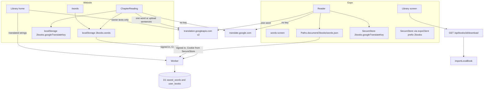
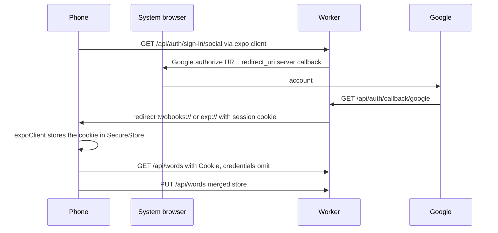
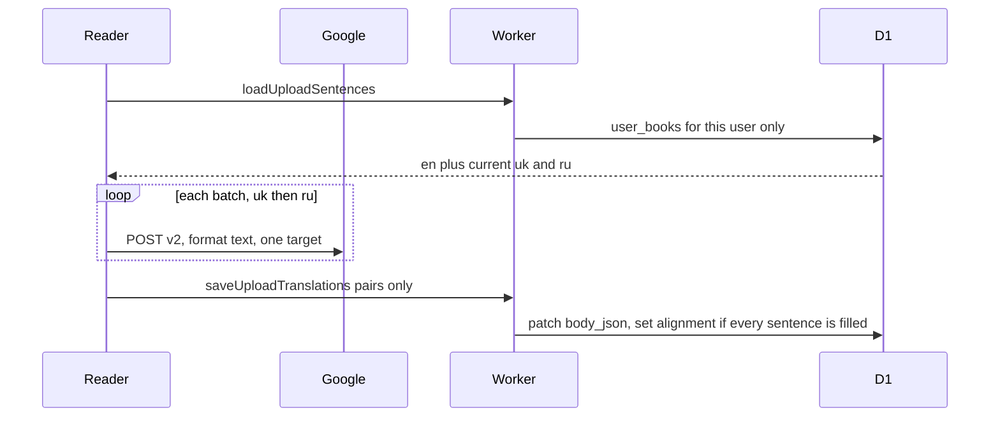

# One-word translation, shared word list, catalog download, upload translation, and speech

|        |                                                                                                                            |
| ------ | -------------------------------------------------------------------------------------------------------------------------- |
| Author | 2books design                                                                                                              |
| Date   | 2026-11-09                                                                                                                 |
| Status | Draft                                                                                                                      |
| Scope  | Website (`src/`) and phone (`apps/mobile`). No deploy, no GitHub PR, no commit unless the implementer is asked separately. |

## Overview

The reader can already look up a Gift of the Magi lemma, save it on one device, export a one-line Anki card, download a public book from the website, and upload English text that stays untranslated (`alignment = 'pending'`). The phone can import a `.2books` file the person already has, but it cannot download the catalog, sign in, or see the website's word list.

This design adds six product features, specified as seven numbered sections below. Phone sign-in is section 4, inside the shared word-list feature. The device calls Google Cloud Translation API v2 with a key that never reaches the 2books Worker. A glossary hit stays on screen; a separate Translate action fetches one normalized word. Saving a word stores that gloss plus the English sentence and the native line the reader was looking at, and the Anki file puts those parts on the back of a stock Basic note. Signed-in devices share one private D1 list, last-write-wins by timestamp, with tombstones so a delete is not resurrected. The phone signs in through the existing Better Auth Google provider and the existing `user` table. The phone downloads `GET /api/books/$bookId/download` and imports the bytes with `importLocalBook`. An owned upload is translated only when that user asks, in the browser, and the Worker only stores the resulting `uk` and `ru` strings. Speech uses `speechSynthesis` on the website and `expo-speech` on the phone, one English sentence at a time.

## Background & Motivation

Word lookup is `lookupWord` in `src/dictionary/lookup.ts` (the Gift of the Magi glossary). The website shows it in `ChapterReading` inside `src/reader/reader-screen.tsx`. The phone duplicates that block in `apps/mobile/components/reader.tsx`. Both save through `addSavedWord` (`src/dictionary/saved-words.ts`). The website persists `localStorage["2books.words"]` (`src/dictionary/use-saved-words.ts`). The phone persists `Paths.document/2books/words.json` (`apps/mobile/lib/saved-words-store.ts`). Neither store has a sentence, and the two stores never meet.

`ankiDeck` writes one TSV line per word: normalized word, tab, gloss. Headers are `#separator:tab`, `#html:false`, `#notetype:Basic`, `#deck:2books`.

Uploads go through `prepareUpload` (`src/library/upload-input.ts`: title 1–120, text trimmed length ≤ 100_000, ≤ 200 sentences) and `insertUserBook` (`src/library/books.server.ts`). `uploadedBook` stores one chapter `c1`, sentences `s1…`, `uk` and `ru` empty, `alignment` `'pending'`. `listMyBooks` sets `alignmentPending` when `alignment !== "ready"`. The home page (`src/routes/index.tsx`) shows that note and offers `GET /api/books/$bookId/download?lang=uk|ru` for catalog books only. `writeTwoBooksPrefer` (`src/library/two-books-write.ts`) falls back to the other native language. `downloadSlug("gift-of-the-magi")` is `gift-of-the-magi-reader`.

The phone library (`apps/mobile/app/index.tsx`) lists catalog rows from `GET /api/books` and local rows from `importLocalBook`. There is no sign-in (`docs/design/mobile-reader.md`). Auth on the website is Better Auth 1.7.18 (`src/auth/auth.server.ts`): Google only, `emailAndPassword.enabled: false`, plugins `[admin(), tanstackStartCookies()]`, callback `http://localhost:3001/api/auth/callback/google`. The session cookie is read by `readCurrentUser` (`src/auth/session.server.ts`). `CurrentUser` is `{ id, email, name, nativeLanguage, role }`.

`apps/mobile/metro.config.js` allow-lists a few pure files under `src/`. Anything else, including `#/` imports and D1, must stay off the phone bundle.

## Goals & Non-Goals

### Goals

- One tapped English word translates to the reader's current native language (`uk` or `ru`) on the website and the phone, from the device, with the reader's own key.
- The glossary line stays. Translate is a separate action. The Google line, when it exists, is the gloss that Save writes.
- With no key, that same control opens the public Google Translate page for that word only. It does not prefetch.
- A saved word stores the normalized word, gloss, native language, `savedAt`, English sentence, and the native line `nativeLine` showed, including the empty-translation fallback.
- Anki stays a Basic TSV. Front is the word. Back is gloss, English sentence, native sentence, blank line between present parts. Old rows without a sentence still export.
- One private list per signed-in account, shared by website and phone. Signed-out use stays on the device. Sign-in merges. Sign-out does not wipe the device. Deletes sync with tombstones.
- The smallest phone Google sign-in that reuses Better Auth and the existing `"user"` table.
- Phone catalog download uses the existing download route and `importLocalBook` / `parseTwoBooksArchive`. `lang` is the phone's native language. Magi is stored as `gift-of-the-magi-reader`.
- The owner of an upload can ask the browser to fill `uk` and `ru`. The Worker never calls Google and never translates a catalog book or the admin-imported novel.
- The selected English sentence can be read aloud. One utterance. Stop on sentence change, dismiss, or a second tap.
- New UI strings in Ukrainian, Russian, and English in both message catalogs that the surface touches.

### Non-Goals

- Scraping `translate.google.com` or `2books.su`. Calling Google from the Worker. An unofficial endpoint. Putting the key in `.dev.vars`, a 2books URL, a log line, Anki, or a sync body.
- Sending the sentence or the book for the one-word action. Machine-translating text the user did not upload. Translating public catalog books. A second parser, a second user table, or a custom Anki note type.
- Changing the JSON of `GET /api/books` or `GET /api/books/$bookId`. Editing migrations `0001`–`0004`. Hand-editing `src/routeTree.gen.ts`. Enabling new `@shadcn/lint` rules. Rewriting the root README.
- Phone upload of new texts, phone edits of `user.nativeLanguage`, server reading progress on the phone, web font/size/paper on the phone.
- Fixing the known bugs listed under Out of scope. Deploying. Opening a GitHub PR. Quoting novel prose. Naming the admin email.
- iOS or Android runs on this machine. They are not available here (no `adb`, no emulator, Linux).

## Key Decisions

1. **Glossary stays; Translate is opt-in.** A glossary hit remains the first line. Google runs only when the reader presses Translate, including when a gloss already exists. Save writes the Google line if one is showing, otherwise the glossary string, otherwise `""`. The in-progress word "Translating…" is never saved.
2. **Official v2 JSON POST, key only on Google's URL.** `POST https://translation.googleapis.com/language/translate/v2?key=<key>` with `format: "text"`. The key is never attached to a 2books origin. `format` is `text` because the API default is HTML.
3. **No Worker proxy if the browser blocks CORS.** A failed `fetch` shows the failure string. It does not fall through to the website, and it does not gain a Worker route. The no-key path is the only path that opens `translate.google.com`.
4. **Sentences live on the saved-word row.** `sentenceEn` and `sentenceNative` default to `""` for old rows. Re-save replaces gloss, both sentences, and `savedAt`. The native sentence is the exact `nativeLine` string, including the localized "no translation yet" fallback.
5. **Anki blank lines are inside a quoted Back field.** Each part still passes through `ankiField` (tabs and newlines become spaces). Parts join with a real `\n\n`. The Back field is CSV-quoted when it contains a quote or a newline, so Anki keeps one Basic note. A gloss-only row stays the old unquoted line.
6. **Tombstones, not a full-table replace.** Key is `nativeLanguage + ":" + normalizedWord`. Newer effective time wins. Equal time: a tombstone beats a live row. Equal time, both live: greater gloss, then `sentenceEn`, then `sentenceNative`, compared with JavaScript `<` (SQLite `BINARY` for this alphabet). On the server, equal text keeps the incoming row (`mergeWordStores(stored, incoming)`); on the client, equal text keeps the remote row (`mergeWordStores(local, remote)`), because the client merges before it PUTs. A complete tie follows that same argument order: the second argument wins. List order is a different comparator and stays `localeCompare`. A newer save after a delete resurrects. An older save does not.
7. **Phone auth is `@better-auth/expo` 1.7.18 against the existing server.** Plugin list becomes `[expo(), admin(), tanstackStartCookies()]`. Google's redirect URI stays `http://localhost:3001/api/auth/callback/google`. The app scheme is a Better Auth trusted origin, not a second Google redirect URI. No new client secret.
8. **Phone does not write `user.nativeLanguage` after sign-in.** A new account stores `uk` or `ru` from the OAuth state's `nativeLanguage`, read with `getOAuthState()` inside the existing create hook. Passing `additionalData` is not enough: Better Auth 1.7.18 does not copy that object onto the Google profile. A later sign-in does not run the create hook and does not change the column. The phone does not call `setUserNativeLanguage`. Word keys use the language on screen at save time.
9. **Catalog download is a capped `fetch` into the cache, then `importLocalBook`.** No second parser. `allowEmptyAuthor` stays the importer's existing `true`. The reserved id is unchanged.
10. **Upload translation is browser-side and owner-only.** Partial Google success is written only for sentences that received both a non-empty `uk` and a non-empty `ru`. `alignment` becomes `ready` only when every stored sentence has both. Empty Google output is a failure. Abort writes nothing. Catalog and bundled ids are unreachable because the handler reads `user_books` for the session user.
11. **Speech is the English sentence, explicit, one at a time.** Website `speechSynthesis`, phone `expo-speech@~58.0.3`. Language is `en-US` on the website and on iOS, and `en` on Android. An utterance generation id ignores end and error events from a cancelled utterance. A word tap inside the same sentence does not stop speech. Changing or clearing the sentence does. Wide layout still gets the control (the known missing wide dismiss button is not fixed here).
12. **Shared pure modules, phone allow-list extended only for those files.** `saved-words.ts` grows the store. New `src/dictionary/google-translate.ts` and `src/library/upload-translation.ts` import nothing from `#/` or the DOM. Metro may import them. The phone does not import `src/auth/**` or `src/library/books.server.ts`.

## Proposed Design

### Architecture



The public catalog responses stay on `catalogResponse` (`src/library/http-cache.ts`): `Access-Control-Allow-Origin: *` and a public cache. Word routes and upload-translation server functions set `Cache-Control: private, no-store` and `Vary: Cookie`. They do not set `Access-Control-Allow-Origin`. React Native `fetch` is not a browser, so it does not need CORS. The website calls `/api/words` same-origin.

### Shared pure modules

| Module                                | Imports                                               | Who calls it                            |
| ------------------------------------- | ----------------------------------------------------- | --------------------------------------- |
| `src/dictionary/saved-words.ts`       | `./lookup` `normalizeWord` only                       | Web hook, phone store, Anki, tests      |
| `src/dictionary/google-translate.ts`  | none                                                  | Web client, phone client, tests         |
| `src/library/upload-translation.ts`   | none                                                  | `saveUploadTranslations` handler, tests |
| `src/dictionary/word-sync.ts`         | saved-words, `fetch`, `localStorage` inside functions | Website only. Not Metro.                |
| `apps/mobile/lib/google-translate.ts` | pure module + `fetch`                                 | Phone reader                            |
| `apps/mobile/lib/word-sync.ts`        | saved-words, auth cookie, `fetch`                     | Phone                                   |
| `apps/mobile/lib/catalog-download.ts` | `importLocalBook`, `ARCHIVE_LIMIT`                    | Phone library                           |

Add the two new pure files to `allowedRelatives` in `apps/mobile/metro.config.js` the same way `saved-words.ts` is listed (the file and its ancestor directory). Do not allow `word-sync.ts`, `upload-translation.ts`'s caller, or any server file. `upload-translation.ts` is pure and does not need to be on the phone; do not add it to Metro.

`lookup.ts` stays the glossary. Do not add lemmas. Google is not a fallback inside `lookupWord`.

### 1. One-word Google translation

#### When the control shows

On an open sentence with a selected word token (`selectedWord.kind === "word"`), the existing dictionary block stays. Under it, add a text button labeled `translateWord`. The button is disabled while a request for this word is in flight. It is hidden when `normalizeWord(selectedWord.text)` is `""`.

The glossary line does not change: `message(locale, "noDictionaryEntry")` or the glossary string. The Google line is a second paragraph, shown only after a successful response for this exact normalized word and this exact native language. Changing the selected word, the sentence, the native language, or dismissing the sentence drops the Google line and aborts the `fetch`.

#### No key

Read the key at click time, not from state captured at mount.

- Website: `localStorage.getItem("2books.googleTranslateKey")`.
- Phone: `SecureStore.getItemAsync("2books.googleTranslateKey")`. Missing module or a thrown store read counts as no key.

Trim. Length 0 means no key. Then open this URL and return. Do not `fetch`.

```text
https://translate.google.com/?sl=en&tl=<uk|ru>&text=<encodeURIComponent(normalizedWord)>
```

`tl` is the reader's current native language. The text is the normalized word, never the sentence, never the surface punctuation that `normalizeWord` strips.

- Website: `window.open(url, "_blank", "noopener,noreferrer")`. If it returns `null`, show `translateFailed`. Do not navigate the reader.
- Phone: `Linking.openURL(url)` from `expo-linking`. A rejection shows `translateFailed`.

#### Key present

```ts
const body = {
  q: [normalizedWord],
  source: "en",
  target: nativeLanguage,
  format: "text" as const,
};
```

`POST` the JSON (`Content-Type: application/json`) to `googleTranslateEndpoint(key)`. Timeout 15 seconds (`AbortSignal.timeout`, combined with the selection abort). One request at a time per reader. Do not send the sentence.

`googleTranslateEndpoint` (in the pure module) builds `URL`:

- throws if the trimmed key is empty or longer than 200
- `origin` is `https://translation.googleapis.com`
- `pathname` is `/language/translate/v2`
- search param `key` is the trimmed key
- nothing else is in the query

Callers must not log the URL, the key, the request, or the response body. On failure, `console.error("google-translate", status)` with the HTTP status number, or `"google-translate", "network"` when there is no status. Never interpolate the key or the word into that message.

Parse with `readTranslations(body, 1)` from the pure module. Success is a single non-empty decoded string. Show it in the second paragraph. Failure shows `translateFailed` and leaves the glossary line. Do not open the website after a failure. Do not treat the source text echoed back as a failure: a non-empty string counts, even if it equals the word. An empty string, a missing `translations` array, or the wrong length is a failure.

While the request runs, show `translating` and set `aria-busy="true"` on the dictionary block (website). The phone shows the same string under the glossary line.

#### What Save writes

```ts
const glossToSave =
  googleLine !== null && googleLine !== ""
    ? googleLine
    : (lookupWord(surface, nativeLanguage) ?? "");
```

`googleLine` is used only if it belongs to the current normalized word and native language. Save stays available when the word is already saved, so a Google result can replace the stored gloss. The existing remove control stays when `hasSavedWord` is true. Remove does not run a translation.

Pressing Translate again refetches. It does not hide the previous Google line until the new request succeeds or fails. On failure, the previous Google line for this word remains.

#### Key editor

On the website `/words` page and the phone words screen, above the Anki button:

- If no key is stored: a password input (`autoComplete="off"`, `spellCheck={false}`, website `id="google-translate-key"` and `name="google-translate-key"`), the hint `googleKeyHint`, and a `googleKeySave` button. Do not use a `<form>` that can submit to the server.
- `googleKeyLabel` is the accessible name of that empty input. On the website it is `<label htmlFor="google-translate-key">`. On the phone it is `accessibilityLabel` on the input. `googleKeyHint` is extra help, not the name. Do not put the stored key in the label or in the value. This is the WCAG 2.1 AA name for the control.
- If a key is stored: do not put it back into the input's value. Show `googleKeySaved`, a `googleKeyClear` button, and the same empty input to replace it. The empty input keeps `googleKeyLabel` as its name.
- Save trims. Empty clears the key. Length greater than 200 shows `googleKeyTooLong` and does not write.
- Clear removes the storage entry.
- Website storage write is `localStorage.setItem("2books.googleTranslateKey", trimmed)`.
- Phone storage write is `SecureStore.setItemAsync("2books.googleTranslateKey", trimmed)`.
- The key is not rendered, not copied into the Anki file, and not sent to `/api/words`.

`maxGoogleKeyLength` is 200, exported from `google-translate.ts`.

#### Pure translate helpers

```ts
export const translateRequestCharLimit = 4_500;
export const translateRequestStringLimit = 128;
export const translateRequestByteLimit = 90_000;
export const maxGoogleKeyLength = 200;

export function googleTranslateEndpoint(key: string): URL;

export function packTranslateBatches(texts: readonly string[]): {
  batches: { indexes: number[] }[];
  unpackable: number[];
};

export function decodeTranslateText(value: string): string;

export function readTranslations(
  body: unknown,
  expected: number,
): ({ text: string } | { text: null })[] | null;
```

`packTranslateBatches` walks the texts in order and packs a batch until one more string would exceed 128 strings, 4_500 code points (UTF-16 length, `String.length`), or 90_000 UTF-8 bytes of `JSON.stringify({ q, source: "en", target: "uk", format: "text" })`. `uk` and `ru` are the same length, so one pack is used for both targets. A string that cannot fit in an empty batch is listed in `unpackable` and is not placed in a batch. An empty input returns no batches and no unpackable indexes.

`decodeTranslateText` decodes once, not recursively: `&amp;`, `&lt;`, `&gt;`, `&quot;`, `&apos;`, `&#NNN;` (decimal, 0–1114111), `&#xHH;` (hex). Invalid code points are left unchanged. Then `trim`. This repairs the entities v2 sometimes still returns. It is not an HTML parser.

`readTranslations` returns `null` unless `body.data.translations` is an array of `expected` objects and each `translatedText` is a string. Each item is `{ text: null }` when the decoded trim is empty, otherwise `{ text }`.

`src/dictionary/google-translate.test.ts` locks the endpoint host, the limits, unpackable input, entity decode (`&amp;lt;` stays `&lt;`), and a wrong-length body. Tests must not call Google and must not contain a real key. Use the literal `test-key` only inside the endpoint test and assert it is the search param, not a 2books host.

### 2. Sentences on the saved word and in Anki

#### Types

```ts
export type SavedWord = {
  word: string;
  gloss: string;
  nativeLanguage: NativeLanguage;
  savedAt: number;
  sentenceEn: string;
  sentenceNative: string;
};

export type WordTombstone = {
  word: string;
  nativeLanguage: NativeLanguage;
  deletedAt: number;
};

export type SavedWordStore = {
  words: SavedWord[];
  tombstones: WordTombstone[];
};
```

Limits, next to the existing `savedWordLimit = 2_000`, `maxWordLength = 80`, `maxGlossLength = 500`:

- `maxSentenceLength = 2_000`
- `tombstoneLimit = 2_000`
- timestamps are safe integers in `0 .. 9_000_000_000_000` inclusive

`parseSavedWordStore` accepts:

- a legacy array of word rows (tombstones `[]`)
- `{ words, tombstones }` (unknown extra fields dropped)
- anything else → empty store

A legacy row with no `sentenceEn` / `sentenceNative` gets `""`. Gloss trim-and-slice and word normalization stay as `asSavedWord` does now. Sentences are `trim` then `slice(0, 2000)`. A non-string sentence becomes `""`. One key is never both live and a tombstone: the newer effective time stays; on a tie the tombstone stays.

Live words sort by `savedAt` descending, then `left.word.localeCompare(right.word)`, then slice to 2_000. Tombstones sort by `deletedAt` descending, then the same `localeCompare`, then slice to 2_000. That is today's order in `parseSavedWords` (`src/dictionary/saved-words.ts`). JavaScript `<` is not this comparator. `<` is only the merge text tie in Key Decision 6.

`parseSavedWords` returns the live-word array. It is a compatibility reader of a legacy array, or of `store.words`. It is not the write path.

`addSavedWord` and `removeSavedWord` take a store and return a store:

```ts
export function addSavedWord(
  store: SavedWordStore,
  input: {
    word: string;
    gloss: string;
    nativeLanguage: NativeLanguage;
    savedAt: number;
    sentenceEn: string;
    sentenceNative: string;
  },
): SavedWordStore;

export function removeSavedWord(
  store: SavedWordStore,
  word: string,
  nativeLanguage: NativeLanguage,
  deletedAt: number,
): SavedWordStore;
```

Today both functions take and return `SavedWord[]`. `use-saved-words.ts` writes `JSON.stringify(words)` and `saved-words-store.ts` writes `JSON.stringify(words)`. Leaving that return type drops `tombstones` on every save and delete. Re-saving the same key replaces gloss, both sentences, and `savedAt`, and drops a tombstone for that key. An invalid key returns the parsed store unchanged and does not add a tombstone. Removing a missing word still writes a tombstone when the key is valid, so a delete can propagate.

`hasSavedWord` looks at live rows only. UI state may be that live array. The hook and the phone file still persist the whole store.

Website persistence writes `JSON.stringify({ words, tombstones })` under `2books.words`. The phone file is the same JSON. Both paths read with `parseSavedWordStore`. Legacy bare arrays remain readable. Readers of the old array still work.

#### What the reader passes

Save is only rendered for an open word, so there is always an open sentence. Both readers pass:

- `sentenceEn`: `selected.en` unchanged (not re-trimmed beyond what is stored; the store trims and caps)
- `sentenceNative`: the exact string already computed for that sentence by `nativeLine` (`src/reader/reader-screen.tsx` and `apps/mobile/lib/native-line.ts`), including `message(locale, "noTranslation")` when both language fields are empty, and including the other language when the current one is empty

The website `useSavedWords().save` signature becomes:

```ts
save(
  word: string,
  gloss: string,
  nativeLanguage: NativeLanguage,
  sentence: { en: string; native: string },
): void
```

The phone `rememberWord` takes the same sentence object. `forgetWord` / `remove` pass `Date.now()` as `deletedAt`.

#### Anki

```ts
function ankiField(value: string): string {
  return value.replaceAll("\t", " ").replaceAll("\r", " ").replaceAll("\n", " ");
}

function quoteAnkiField(value: string): string {
  if (!/["\n\r\t]/.test(value)) return value;
  return `"${value.replaceAll('"', '""')}"`;
}
```

Back parts are `ankiField` of gloss, `sentenceEn`, `sentenceNative`, dropping `""`, joined with `\n\n`. Front is `ankiField(word.word)`. Each side is then `quoteAnkiField`. Headers stay exactly:

```text
#separator:tab
#html:false
#notetype:Basic
#deck:2books
```

A gloss-only row is still `pennies\tпенні\n` at the end of that line (the file still ends with a newline). A full row is one physical record:

```text
pennies\t"пенні\n\nOne dollar.\n\nОдин долар."
```

The website export and the phone share keep filtering to the current native language before calling `ankiDeck`. Tombstones are not exported. The Google key is not exported. The phone share path (`apps/mobile/app/words.tsx`) is unchanged aside from the richer text: file `2books-words.txt` in the cache, then `expo-sharing`, then `Share.share` of the text. Do not share the key file.

The words list, on both clients, shows `sentenceEn` under the gloss when it is non-empty, and `sentenceNative` under that when it is non-empty. Empty gloss still hides the gloss line.

#### Merge

```ts
export function mergeWordStores(local: SavedWordStore, remote: SavedWordStore): SavedWordStore;
```

For each key in the union, consider the local live row, the local tombstone, the remote live row, and the remote tombstone. Effective time is `savedAt` for a live row and `deletedAt` for a tombstone. Higher time wins. Equal time: tombstone beats live. Equal time and both live: compare gloss, then `sentenceEn`, then `sentenceNative` with JavaScript `<` / `>`. On the server, equal text keeps the incoming row (`mergeWordStores(stored, incoming)`); on the client, equal text keeps the remote row (`mergeWordStores(local, remote)`), because the client merges before it PUTs. The function implements that by keeping the second argument when the text also ties. Then run the result through `parseSavedWordStore`. List order stays `localeCompare` and is not this comparison.

### 3. Account word list

#### Table

New file `migrations/0005_saved_words.sql`. Do not edit `0001`–`0004`. Placeholder D1 id in `wrangler.jsonc` stays `00000000-0000-0000-0000-000000000000`.

```sql
CREATE TABLE saved_words (
  user_id TEXT NOT NULL,
  word_key TEXT NOT NULL,
  word TEXT NOT NULL,
  gloss TEXT NOT NULL,
  native_language TEXT NOT NULL,
  sentence_en TEXT NOT NULL DEFAULT '',
  sentence_native TEXT NOT NULL DEFAULT '',
  saved_at INTEGER NOT NULL,
  deleted_at INTEGER,
  PRIMARY KEY (user_id, word_key)
);

CREATE INDEX saved_words_user_saved_at ON saved_words (user_id, saved_at);
```

`deleted_at IS NULL` is a live row. A tombstone has `deleted_at` set. There is no foreign key, matching `progress` and `user_books`. `deleteUser` in `src/admin/dashboard.server.ts` adds this statement to the existing batch, after the `user_books` delete:

```sql
DELETE FROM saved_words WHERE user_id = ?
```

Do not delete this table on sign-out. A banned user fails `readCurrentUser` and cannot read or write the rows; the rows stay until the account is deleted.

Apply locally with `bunx wrangler d1 migrations apply 2books --local` only if a local D1 is already part of the dev loop. Do not apply a remote database. Unit tests do not need D1.

#### HTTP

`src/routes/api/words.ts`, route `/api/words`. The Vite plugin regenerates `src/routeTree.gen.ts`. Handlers: `GET` and `PUT` only.

Every response, including errors:

```text
Cache-Control: private, no-store
Vary: Cookie
```

No `Access-Control-Allow-Origin`. Body is JSON. Do not log success. Do not log words, glosses, sentences, cookies, or the Google key. On a failure response only, `console.error("words-sync", status, userId)`. No `console.info`. No `key=`.

Session is `readCurrentUser()`. Null session:

```json
{ "error": "anonymous" }
```

status 401.

`GET` returns the store built from that user's rows, passed through `parseSavedWordStore` so the caps and the one-key invariant hold. Shape:

```json
{
  "words": [
    {
      "word": "pennies",
      "gloss": "пенні",
      "nativeLanguage": "uk",
      "savedAt": 2,
      "sentenceEn": "One dollar.",
      "sentenceNative": "Один долар."
    }
  ],
  "tombstones": [{ "word": "watch", "nativeLanguage": "ru", "deletedAt": 3 }]
}
```

`PUT` requires the `Content-Type` header to contain `application/json`. A missing or non-JSON media type is 400 `{ "error": "invalid" }` and writes nothing, including when the body would otherwise parse. Fetch does not add `Content-Type` for a string body, so both clients set the header themselves.

`savedWordBodyLimit` is 28_300_000. A compact `JSON.stringify` of the largest store `parseSavedWordStore` can emit is 28_290_026 bytes: 2_000 live rows plus 2_000 tombstones, every text field filled to its cap with U+FFFF (3 UTF-8 bytes, not escaped by `JSON.stringify`), `savedAt` / `deletedAt` at 9_000_000_000_000, and `nativeLanguage` `"uk"`. One live object is 13_844 bytes and one tombstone is 299 bytes. If `Content-Length` is present and greater than 28_300_000, or the read body is longer than that, 413 `{ "error": "invalid" }` and write nothing. Do not lower the 2_000-character sentence cap to make a smaller body. The Workers request-body limit is about 100 MB; 28_300_000 is this route's cap. Clients send that compact stringify, with no extra whitespace. A store returned by `parseSavedWordStore` always fits.

A body that does not parse as a store of valid rows (the pure parser drops bad rows; if the top-level value is not an array and not an object with `words`) is 400 and writes nothing. A timestamp outside the integer range, a native language other than `uk`|`ru`, or a non-string field on a row causes that row to be ignored by the parser, not a 400, matching `parseSavedWords` today. An empty object `{ "words": [], "tombstones": [] }` is valid and merges nothing.

The handler loads the user's rows, builds a store, runs `mergeWordStores(stored, incoming)`, and upserts the difference per key. It does not delete keys the client simply omitted: omission is not a delete. Only a tombstone deletes. After the upserts, prune in this order:

1. If a key is live, it is not also a tombstone (the upsert already cleared `deleted_at`).
2. Delete live rows for this user that are outside the newest 2_000 by `saved_at DESC, word ASC`.
3. Delete tombstones outside the newest 2_000 by `deleted_at DESC, word ASC`.

Do the merge in JavaScript and write only keys whose winner differs from the stored row. The `ON CONFLICT DO UPDATE` is still conditional, with the same winner rule as `mergeWordStores`. A blind update would let a later `PUT` of an older `saved_at` replace a newer row. Different keys stay safe because each write is one key, not a full-table replace. After this conditional update, a residual same-key race is Low.

`GET` builds tombstones only from rows where `deleted_at IS NOT NULL`. It does not read `gloss` or `saved_at` for those rows. `word` and `native_language` come from the stored columns, which match `word_key`.

Live winner. `saved_at` is the incoming `savedAt`, `deleted_at` is inserted as NULL. Update only when the incoming time beats the stored effective time (`saved_at` when `deleted_at IS NULL`, otherwise `deleted_at`), or when the stored row is live, the times are equal, and the incoming gloss, then `sentence_en`, then `sentence_native` is greater under SQLite's binary `<`, or all three are equal. Equal text keeps the incoming row. Equal time against a stored tombstone does not update.

```sql
INSERT INTO saved_words (
  user_id, word_key, word, gloss, native_language,
  sentence_en, sentence_native, saved_at, deleted_at
) VALUES (?, ?, ?, ?, ?, ?, ?, ?, NULL)
ON CONFLICT(user_id, word_key) DO UPDATE SET
  word = excluded.word,
  gloss = excluded.gloss,
  native_language = excluded.native_language,
  sentence_en = excluded.sentence_en,
  sentence_native = excluded.sentence_native,
  saved_at = excluded.saved_at,
  deleted_at = NULL
WHERE excluded.saved_at > CASE
    WHEN saved_words.deleted_at IS NULL THEN saved_words.saved_at
    ELSE saved_words.deleted_at
  END
  OR (
    saved_words.deleted_at IS NULL
    AND excluded.saved_at = saved_words.saved_at
    AND (
      excluded.gloss > saved_words.gloss
      OR (excluded.gloss = saved_words.gloss AND excluded.sentence_en > saved_words.sentence_en)
      OR (
        excluded.gloss = saved_words.gloss
        AND excluded.sentence_en = saved_words.sentence_en
        AND excluded.sentence_native >= saved_words.sentence_native
      )
    )
  );
```

The `>=` on the last sentence is the complete text tie: incoming wins. A strictly greater sentence also wins. A lesser sentence does not.

Tombstone winner, including a key the server has never stored. Insert `gloss = ''`, `sentence_en = ''`, `sentence_native = ''`, `saved_at = deleted_at`, and `deleted_at = deleted_at`. `word` and `native_language` come from `savedWordKey` (`uk:pennies` → word `pennies`, language `uk`). On conflict, set those same empties. Do not leave the previous gloss in the row. Update only when `excluded.deleted_at` is greater than the stored effective time, or when the times are equal and the stored row is live (a tombstone beats a live row). Equal time and a stored tombstone: do not update.

```sql
INSERT INTO saved_words (
  user_id, word_key, word, gloss, native_language,
  sentence_en, sentence_native, saved_at, deleted_at
) VALUES (?, ?, ?, '', ?, '', '', ?, ?)
ON CONFLICT(user_id, word_key) DO UPDATE SET
  word = excluded.word,
  gloss = '',
  native_language = excluded.native_language,
  sentence_en = '',
  sentence_native = '',
  saved_at = excluded.deleted_at,
  deleted_at = excluded.deleted_at
WHERE excluded.deleted_at > CASE
    WHEN saved_words.deleted_at IS NULL THEN saved_words.saved_at
    ELSE saved_words.deleted_at
  END
  OR (
    saved_words.deleted_at IS NULL
    AND excluded.deleted_at = saved_words.saved_at
  );
```

Chunk statements with `db.batch` in groups of 50. A failed batch returns 500 `{ "error": "unavailable" }` and does not claim success. The response on 200 is the store read back after the prune, not an echo of the request. Repeating the same `PUT` is a no-op and returns the same store.

`word_key` is the string `savedWordKey` already returns (`uk:pennies`). Reject a key that is not that function's result by not inserting it.

These rows must not be added to `listCatalogSummaries`, `readPublicCatalogBook`, or either public book route.

#### Website client

`src/dictionary/word-sync.ts` has one single-flight pipeline. `scheduleWordSync` and `flushWordSync` both enqueue it through the same 300ms debounce. `flushWordSync` is not a second algorithm and it is not a no-op.

- Every local save or remove bumps a generation counter, then calls `flushWordSync` when a user id is known.
- `scheduleWordSync(userId: string | null)`: `userId` null cancels the debounce and does not fetch. An in-flight pipeline that observes a null user before it replaces storage does not write the response and does not `PUT`.
- Do not start a second `GET` while a pipeline is running. A write during the pipeline only bumps the generation. The running pipeline sees that before it replaces storage.
- On fire: `GET /api/words` with `credentials: "same-origin"`, `cache: "no-store"`, and `accept: "application/json"`. Merge `mergeWordStores(local, remote)`. `PUT` the merged store with `content-type: application/json` and `accept: "application/json"` on that `PUT`. The body is compact `JSON.stringify(store)`.
- Immediately before replacing local storage, read the generation again. If it moved, merge the response with the current store (`mergeWordStores(current, response)`) and `PUT` again. Each of those `PUT`s counts toward 3. If the generation is unchanged, replace local with the response body and clear `syncFailed`.
- If the limit of 3 is hit and the generation still moved, keep the local store, surface `syncFailed`, clear the pending enqueue, and do not start another `GET`. The next local save is the only later attempt, and that attempt has a fresh budget of 3.
- A 401 on `GET` or `PUT` leaves the local store untouched and does not replace it with an empty store. It does not surface `syncFailed`.
- A network error, 400, 413, or 500 leaves the local store and surfaces `syncFailed`. Do not delete words to shrink a 413.

`AppShell` (`src/shell/app-header.tsx`) calls `scheduleWordSync(user?.id ?? null)` when `user.id` changes. That is the sign-in merge. Sign-out (`onSignOut`) still only calls `signOut` and `router.invalidate`. It must not remove `2books.words`. After invalidate, `user` is null and sync stops. The local list, including tombstones created while signed out, remains for the next sign-in.

`useSavedWords` writes the local store first, dispatches `2books-words` as it does now, then `flushWordSync`. The words page and the reader both use this hook. They do not each GET on mount; `AppShell` owns the sign-in GET. A words-page focus in the same signed-in session still has the latest local store because saves write local immediately.

Show `syncFailed` as a non-blocking line on `/words` when the last sync failed. Clear it on the next success. Do not show it in the reader.

Signed-out saves never call `fetch`.

#### Phone client

Covered with sign-in below. The phone uses the same merge function, the same JSON, and the same single-flight pipeline. `PUT` sets `content-type: application/json`. It sends the session cookie from `authClient.getCookie()` and `credentials: "omit"`. It does not send the catalog download cookie. A 401 keeps the file.

### 4. Phone Google sign-in

#### Dependencies

Root package, from the repo root, with bun (not npm; npm inside this repo fails `EBADDEVENGINES` because `devEngines.packageManager` requires bun 1.4.4):

```bash
bun add @better-auth/expo@1.7.18
```

Do not upgrade `better-auth` off 1.7.18. If the solver moves it, pin `better-auth@1.7.18` in the same change.

From `apps/mobile`:

```bash
bun add better-auth@1.7.18 @better-auth/expo@1.7.18 expo-network@~58.0.4 expo-web-browser@~58.0.7 expo-speech@~58.0.3
```

Those Expo versions are the SDK 58 catalog entries in `apps/mobile/node_modules/expo/bundledNativeModules.json`. `expo-linking@~58.0.16`, `expo-constants@~58.0.15`, and `expo-secure-store@~58.0.2` are already direct dependencies. Do not add `@react-native-google-signin/google-signin`. Do not add a custom dev client. Expo Go can load `expo-web-browser`, `expo-network`, and `expo-speech` for SDK 58. If `bun add` itself throws `EBADDEVENGINES`, rerun that same `bun add` from `/tmp` only to confirm the registry, then add the version strings to `apps/mobile/package.json` by hand and run `bun install` in `apps/mobile`. Do not run `npx expo install` inside the repo.

The Worker imports `expo` from `@better-auth/expo` only. The phone imports `expoClient` from `@better-auth/expo/client` only. The Worker must not import the client entry.

#### Server

`createAuth` plugins become:

```ts
plugins: [expo(), admin(), tanstackStartCookies()],
```

`admin()` stays before `tanstackStartCookies()`. `emailAndPassword`, the Google provider (`prompt: "select_account"`), and `additionalFields.nativeLanguage` stay. Do not add a user table or a migration for auth. Change only the body of the existing `databaseHooks.user.create.before` hook. Do not add a `user.update` hook.

Better Auth 1.7.18 stores `additionalData` as top-level keys of the OAuth state (`generateState` in `node_modules/better-auth/dist/oauth2/state.mjs`). The Google callback (`node_modules/better-auth/dist/api/routes/callback.mjs`) parses that state and does not copy those keys into `userInfo`. `handleOAuthUserInfo` fills extra user columns only from the provider profile (`parseAdditionalUserInputFromProviderProfile` in `link-account.mjs`). Google's profile has no `nativeLanguage`, so the field default `"uk"` is what the hook sees today. `src/auth/auth.server.ts` then stores `"uk"` unless `user.nativeLanguage === "ru"`. The same gap is on the website: `signInWithGoogle` already passes `additionalData: { nativeLanguage }`.

`parseState` calls `setOAuthState` before `handleOAuthUserInfo` creates the user. `getOAuthState` from `better-auth/api` reads that request state. Import it only in `src/auth/auth.server.ts`. The state is client-supplied. Read `nativeLanguage` and nothing else. Do not copy `role`, `email`, `callbackURL`, or `codeVerifier` from it.

```ts
import { getOAuthState } from "better-auth/api";

before: async (user) => {
  const fields = user as { email?: string; nativeLanguage?: unknown; role?: string };
  const email = typeof fields.email === "string" ? fields.email : "";
  const state = await getOAuthState();
  const fromState =
    state !== null && typeof state === "object" ? state.nativeLanguage : undefined;
  const nativeLanguage =
    fromState === "uk" || fromState === "ru"
      ? fromState
      : fields.nativeLanguage === "ru"
        ? "ru"
        : "uk";
  const role = isListedAdmin(email, env.ADMIN_EMAILS) ? "admin" : fields.role;
  return { data: { ...user, nativeLanguage, role } };
},
```

A new user whose state `nativeLanguage` is `"ru"` is stored as `"ru"`. A new user whose state `nativeLanguage` is `"uk"` is stored as `"uk"`. Any other state value, or a null state, keeps today's fallback (`"ru"` only when the user object already says `"ru"`, otherwise `"uk"`). The create hook does not run on a later sign-in, and this change must not update the column then. The phone must not call `setUserNativeLanguage` in `src/auth/session.ts`. The website's existing signed-in language control may still call it. That is not a phone write and it is not a second create path.

`trustedOrigins` in `getAuth` keeps the current `baseURL` and the request origin, and always adds `twobooks://` and `twobooks://*`. When the base URL hostname is `localhost` or `127.0.0.1`, also add `exp://`, `exp://**`, `exp://192.168.*.*:*/**`, `exp://10.*.*.*:*/**`, and `exp://172.*.*.*:*/**`. Do not add the `exp://` patterns when `BETTER_AUTH_URL` is a public host.

`@better-auth/expo` 1.7.18 `init()` also adds `exp://` when `process.env.NODE_ENV === "development"`. Do not rely on that. Workers do not use that hook as the contract, and explicit origins in `getAuth` are the contract. Do not set `NODE_ENV=development` when `BETTER_AUTH_URL` is a public host: that hook would then trust every Expo Go origin. The plugin's `onRequest` copies `expo-origin` onto `origin` and, on Workers, rebuilds the `Request` because incoming headers are immutable. Do not add a second copy of that rewrite.

Better Auth 1.7.18 `matchesOriginPattern` (`node_modules/better-auth/dist/auth/trusted-origins.mjs`) returns true for a custom-scheme pattern whose path is empty. Bare `exp://` therefore matches any `exp://` URL, including Expo Go's `exp://<host>:<port>/--/`. That is why the trusted string is bare `exp://`, and why it is added only for a localhost base.

No new Google Cloud redirect URI. The provider redirect remains:

```text
http://localhost:3001/api/auth/callback/google
```

The only dev setup that keeps that URI is a Worker bound to `localhost:3001`, with the device reaching that same host. Use `adb reverse tcp:3001 tcp:3001`, or an iOS simulator, where `localhost` on the device is the host machine. On a physical device without that reverse, `localhost` is the phone (`apps/mobile/lib/api.ts` defaults to `http://localhost:3001`). The system browser then never reaches the Worker. A LAN `EXPO_PUBLIC_API_URL` would change Google's `redirect_uri` and is out of scope, because this design does not add a redirect URI. The root script `"dev": "vp dev --port 3000"` is the wrong origin for this flow. Do not change the callback to port 3000. Point `EXPO_PUBLIC_API_URL` and `BETTER_AUTH_URL` at `http://localhost:3001`.

The phone deep link is Better Auth's `callbackURL` after the server has the session. The user must not add `twobooks://` to the Google Cloud client. Do not write a client id or client secret into the repo or this document's implementation. `googleAuthConfigured()` is unchanged.

The Expo client rewrites `callbackURL`, `newUserCallbackURL`, and `errorCallbackURL` when they start with `/`, using `Linking.createURL`, before the request. `callbackURL: "/"` becomes `exp://<host>:<port>/--/` in Expo Go (`resolveScheme` ignores the `twobooks` scheme) or `twobooks://` in a dev build. The server plugin appends the raw `Set-Cookie` as `?cookie=` only when the redirect is not `http:` or `https:` and `isTrustedOrigin` accepts it. An HTTP or HTTPS redirect, including the website return to `/sign-in`, is left alone. The cookie reaches SecureStore only because the client rewrites `/` into a trusted non-HTTP URL and then reads `result.url`. A callback that stayed on the website would not deliver the cookie to the phone.

New route `src/routes/api/session/ready.ts` (`GET /api/session/ready`), not under the `/api/auth/$` splat:

```json
{ "google": true }
```

or `false`, from `googleAuthConfigured()`. Headers: `Cache-Control: private, no-store`, `Vary: Cookie`. Status 200 even when Google is off. No secrets.

`apps/mobile/app/+native-intent.ts` keeps the `expo-sharing` hostname check and the `file:` / `content:` enqueue. It also guards the auth return. For `exp:` and `twobooks:`, return `"/"` and do not call `enqueueIncoming`. Do not parse the query and do not log it. The session cookie is in that query (`?cookie=` is the raw `Set-Cookie`). The Expo client already reads `result.url` from `openAuthSessionAsync` (`url.searchParams.get("cookie")`). This guard stops Expo Router from treating that URL as a path. It is not a second auth implementation.

```ts
export function redirectSystemPath({ path }: { path: string; initial: boolean }): string {
  try {
    const url = new URL(path);
    if (url.hostname === "expo-sharing") return "/";
    if (url.protocol === "file:" || url.protocol === "content:") {
      enqueueIncoming({ uri: path, name: null });
      return "/";
    }
    if (url.protocol === "exp:" || url.protocol === "twobooks:") return "/";
  } catch {
    return path;
  }
  return path;
}
```

#### Phone client

`apps/mobile/lib/api.ts` currently declares `function apiBase()` and does not export it. Export that function. Do not add a second base-URL helper. It keeps `EXPO_PUBLIC_API_URL`, default `http://localhost:3001`, and the trailing-slash strip.

`apps/mobile/lib/auth-client.ts`:

```ts
import { createAuthClient } from "better-auth/react";
import { expoClient } from "@better-auth/expo/client";
import * as SecureStore from "expo-secure-store";
import { apiBase } from "@/lib/api";

export const authClient = createAuthClient({
  baseURL: apiBase(),
  plugins: [
    expoClient({
      scheme: "twobooks",
      storagePrefix: "2books",
      storage: SecureStore,
    }),
  ],
});
```

Do not change the default URL in this work. The sign-in origin, the catalog origin, and the Google redirect origin have to be the same host the dev server actually bound, which for this flow is `localhost:3001` reached as specified above.

`apps/mobile/lib/auth.tsx` is a small provider used by `apps/mobile/app/_layout.tsx` inside `SettingsProvider`:

- On mount and on library focus, `authClient.getSession()`.
- `signIn()` calls `authClient.signIn.social({ provider: "google", callbackURL: "/", additionalData: { nativeLanguage } })` with the current settings language (`"uk"` or `"ru"` only). That object reaches the new account only through the create hook's `getOAuthState()` read above. After a resolved result with no error, navigate nowhere if already on `/`; the library is `/`. Then `scheduleWordSync`. Do not update `user.nativeLanguage` after the session exists.
- `signOut()` calls `authClient.signOut()`, then stops sync. It does not delete `words.json`.
- Ready: `GET ${apiBase()}/api/session/ready` with `credentials: "omit"` and no session cookie. Failure to reach it does not hide the library. The sign-in button still shows. A `{ google: false }` result replaces the button with `googleNotConfigured`.

Library screen (`apps/mobile/app/index.tsx`), under the saved-words link:

- Signed out and Google ready: button `signInWithGoogle`. Failure: `googleSignInFailed`.
- Signed out and Google not ready: the not-configured string, no button.
- Signed in: the email as plain text (not a translation key) and a `signOut` button.
- Sync failure: `syncFailed`, non-blocking.

The session cookie is a credential and stays in SecureStore via the Expo client. Do not copy it into `words.json` or `2books.settings`. Word sync uses the same single-flight pipeline as the website, against the file instead of `localStorage`. `PUT` sets `content-type: application/json`. Fetch will not add that header for a string body. A missing media type is the route's 400.

```ts
const cookie = await authClient.getCookie();
const headers: Record<string, string> = { accept: "application/json" };
if (cookie) headers.cookie = cookie;
if (method === "PUT") headers["content-type"] = "application/json";
await fetch(`${apiBase()}/api/words`, {
  method,
  headers,
  credentials: "omit",
  cache: "no-store",
  body: method === "PUT" ? JSON.stringify(store) : undefined,
});
```

`getCookie()` returns a `Promise`. Await it. Header name is `cookie` (fetch lowercases it). Do not also set `credentials: "include"`. `JSON.stringify` is the compact form.

Sign-in merge is that same pipeline: one `GET`, then `mergeWordStores(local, remote)`, then `PUT`, re-read the generation before replacing the file, and at most 3 `PUT`s. Run it when the session first appears, and 300ms after each `rememberWord` / `forgetWord` while a session exists. Signed-out edits only touch the file, including tombstones, so the next sign-in can push a delete whose `deletedAt` is newer than the account row. A 401 does not replace the file with an empty store.

The share-sheet importer is unchanged. `redirectSystemPath` is the guard specified above.

#### What cannot be verified here

No Android SDK, no `adb`, no emulator, and no iOS simulator on this Linux machine. `adb reverse tcp:3001 tcp:3001` cannot be run here, and a device sign-in cannot be claimed. Do not claim a deep link or a SecureStore round trip. `bunx tsc -p apps/mobile --noEmit` and `cd apps/mobile && bun test` are the phone checks. Do not run bare `bun test` from the repo root. The website Google button is still the existing `/sign-in` flow; do not break it. A full Google redirect still needs the existing `.dev.vars` and a browser, and it must not be "fixed" by inventing a secret.



### 5. Phone catalog download

On each catalog row in `apps/mobile/app/index.tsx` (not on local rows), add a `downloadBook` button as a sibling of the Read pressable. Catalog rows are one `Pressable` today. Split the row the way local rows already split Read and Delete, so the download control is its own button. Minimum height 44. Keep the button visible. Set `disabled` and `accessibilityState.disabled` while `importing` is true. The label is `downloading` only on the row that owns the `runImport` lock. Other rows keep `downloadBook` and stay disabled. If `catalogDownloadName(bookId)` returns null, show `downloadFailed` and do not fetch. One download at a time, using the existing `runImport` mutex so it cannot overlap the picker or a share import.

`apps/mobile/lib/catalog-download.ts`:

```ts
export function catalogDownloadName(bookId: string): string | null;

export function downloadLengthDecision(contentLength: number | null): "read" | "reject" | "missing";

export async function downloadCatalogBook(input: {
  bookId: string;
  lang: "uk" | "ru";
  signal: AbortSignal;
}): Promise<
  | { ok: true; id: string }
  | { ok: false; error: "http" | "oversize" | "invalid-input" | "reserved-id" | "io" }
>;
```

`catalogDownloadName` returns `` `${bookId}.2books` `` only when `bookId` matches `/^[a-z0-9]+(?:-[a-z0-9]+)*$/` and its length is 1–80. Otherwise `null` (do not fetch). This is the cache file name, not the stored slug. `gift-of-the-magi.2books` is a legal cache name. The archive's `meta.slug` is still `gift-of-the-magi-reader`, and `importLocalBook` stores that slug. Do not rename it. Do not pass `gift-of-the-magi` as a storage id.

`lang` is `settings.nativeLanguage` at the tap. The URL is:

```text
${apiBase()}/api/books/${encodeURIComponent(bookId)}/download?lang=${lang}
```

`credentials: "omit"`, `accept: "application/octet-stream"`, the provided abort signal. Do not send the session cookie.

- Status other than 200: `{ ok: false, error: "http" }`.
- `Content-Length` present and greater than `ARCHIVE_LIMIT` (25_000_000): do not read the body; `oversize`.
- Prefer `response.body.getReader()` when it is a function. Count bytes. Past 25_000_000, cancel the reader and return `oversize` without writing a file and without calling the parser.
- If `getReader` is missing and `Content-Length` is missing or not a finite number: return `http` and stop. Do not call `arrayBuffer()` on an uncapped body. `src/routes/api/books/$bookId.download.ts` already buffers the archive in a `Blob` and does not set `Content-Length` itself. A length is present only when the runtime sets it from that blob. If a device test shows neither `response.body.getReader` nor `Content-Length`, stop and report that. Do not add a second parser, do not raise `ARCHIVE_LIMIT`, and do not switch to an uncapped `arrayBuffer`.
- If `getReader` is missing and the length is in range: `arrayBuffer()`, then the same 25_000_000 check.

Write the bytes to `new File(Paths.cache, catalogDownloadName(bookId))` with `file.write`, then:

```ts
importLocalBook({
  uri: file.uri,
  name: catalogDownloadName(bookId),
  size: bytes.byteLength,
});
```

`importLocalBook` already parses with `parseTwoBooksArchive` and `allowEmptyAuthor: true`, replaces the same slug, keeps position when the sentence id survives, and deletes the cache file through `deleteIfCache`. Do not call `File.bytes`, `File.size`, or a second unzip. Map the import result:

- `ok: true` → return that id (the archive slug)
- `reserved-id` → `reserved-id`
- `io` → `io`
- the helper's own cap returns `oversize` before `importLocalBook`
- `importLocalBook` maps its own oversize read (`readArchiveBounded` returning `"oversize"`) to `invalid-input`, not `oversize`
- both `oversize` and `invalid-input` use the UI string `importInvalid`

UI messages, using the existing import strings where they already match:

- `http` → `downloadFailed`
- `oversize` or `invalid-input` → `importInvalid`
- `reserved-id` → `importReserved`
- `io` → `importFailed`
- success → `refreshLocal()` and stay on the library. Do not navigate. The local row appears under "On this phone". A second download of Magi replaces `gift-of-the-magi-reader` and keeps the position when sentence ids still match, which is the existing replace rule.

Do not change `src/routes/api/books/$bookId.download.ts`, the public cache headers, or `writeTwoBooksPrefer`. User uploads are not on that route (empty author and empty translations would 404 anyway). Do not add them.

Abort only when the library screen unmounts: abort the signal, do not import a partial buffer. Blur and a later visit do not abort an in-flight download.

### 6. Translation of an owned upload

#### Who may run it

Only a signed-in user, only a row in `user_books` whose `user_id` is that session, only from the website. The phone has no upload UI and does not gain one.

Buttons:

- Home, on each `myBooks` entry: if `alignmentPending`, button `translateBook`. If not pending, button `translateBookAgain`.
- Reader, for the open book: call `uploadTranslationState`. Null (catalog, bundled, anonymous, or not the owner) shows nothing. `pending` shows `translateBook`. `ready` shows `translateBookAgain`.

Both buttons call the same client function. The button is disabled while that book is running. A second click is ignored.

No Google key: do not call Google and do not open `translate.google.com` with the book text. Show `translateBookNeedKey` and a link to `/words`.

#### Load

Server function `loadUploadSentences` in `src/library/api.ts`:

```ts
input: { bookId: string }
output:
  | {
      alignment: "pending" | "ready";
      sentences: { id: string; en: string; uk: string; ru: string }[];
    }
  | null
```

`bookId` must be a string of length 1–80. Session required; otherwise `null` (do not reveal existence). SQL: `SELECT body_json, alignment FROM user_books WHERE id = ? AND user_id = ?`. Missing row → `null`. Parse the JSON only to list sentences. Do not use `parseStoredBook` for the write path, because it drops `paragraph`. This read can return `paragraph` or ignore it; the client only needs `id`, `en`, `uk`, `ru`. Order is chapter order, then sentence order. `privateNoStore()` like `uploadText`.

`uploadTranslationState` is the same query returning `{ alignment: "pending" | "ready" } | null` without the sentences, for the reader banner. Same privacy and cache rules.

Catalog ids, `gift-of-the-magi`, and the admin-imported novel are not in `user_books` for this check. A UUID that belongs to another user returns `null`.

#### Google calls

Client module `src/dictionary/translate-upload.ts` (DOM/`fetch`, not Metro):

1. Load sentences.
2. If `again` is false, keep only sentences whose trimmed `uk` or trimmed `ru` is empty. If `again` is true, translate every sentence.
3. `packTranslateBatches` on the English strings in that order. Indexes in `unpackable` are failures and are not sent.
4. For each batch, in order: POST target `uk`, then POST target `ru`, same `q` list, `source: "en"`, `format: "text"`, timeout 30 seconds, selection/unmount abort signal.
5. Status handling, per request:
   - 401 or 403: stop the whole run. Do not start another batch. Discard pairs already produced in this run. Do not call the server. Leave `alignment` as stored. Show `translateBookNone`. Do not show `translateFailed` or `translateBookPending`.
   - 429: wait 2 seconds, try that request once more. A second 429 stops the whole run the same way: discard in-memory successes, do not call the server, leave `alignment` as stored, show `translateBookNone`.
   - 500, 502, 503, 504, or a network error: try once more immediately. If it fails again, mark that batch's sentences failed and continue with later batches.
   - 400 or any other status: do not retry. Mark that batch failed and continue.
   - 200: `readTranslations`. `null` marks the batch failed. `{ text: null }` marks that sentence failed. A non-empty text is kept. Empty Google text is not a translation.
6. A sentence is savable only when this run produced a `uk` and a `ru` whose trims are each length 1–8_000. Empty text is not a translation. A trim longer than 8_000 is not savable: do not send that pair, and count it in `translateBookSkipped`. Do not save `uk` from a batch whose `ru` failed.
7. On abort, do not call the server.
8. If the savable list is empty, do not call the server. Show `translateBookNone`. The 401, 403, and second-429 stops are this case because they discard earlier batches.
9. Otherwise one call to `saveUploadTranslations`. Per-batch failure after the allowed retry still saves the sentences that have both languages.

Do not send the title. Do not send sentences that were skipped as already filled unless `again` is true. Do not run batches in parallel. Do not log sentence text.

Progress string is `translateProgress(locale, done, total)` where `total` is the number of sentences selected in step 2 and `done` increments when a sentence has both languages resolved or has failed. Put it in an `aria-live="polite"` paragraph.

#### Save

Server function `saveUploadTranslations`:

```ts
input: {
  bookId: string;
  again: boolean;
  sentences: { id: string; uk: string; ru: string }[];
}
output:
  | { ok: true; alignment: "pending" | "ready"; filled: number; remaining: number }
  | { ok: false; error: "anonymous" | "not-found" | "not-pending" | "invalid" | "unavailable" }
```

`privateNoStore()`. Anonymous → `anonymous`. Not the owner, or not a `user_books` row → `not-found` (same response either way). `again === false` and the stored `alignment` is `ready` → `not-pending` and do not write. `again === true` is allowed for `pending` and `ready`.

Publish this pure function from `src/library/upload-translation.ts`. The handler calls it and does not invent a second writer.

```ts
export function applyUploadTranslations(
  storedBody: unknown,
  input: {
    again: boolean;
    sentences: { id: string; uk: string; ru: string }[];
  },
):
  | {
      ok: true;
      body: unknown;
      alignment: "pending" | "ready";
      filled: number;
      remaining: number;
    }
  | { ok: false; error: "invalid" };
```

`again` is not used inside the patcher. The handler rejects `again === false` with stored `alignment === "ready"` before calling it (`not-pending`, no write). These violations return `{ ok: false, error: "invalid" }` and write nothing:

- `sentences` is not an array, or `sentences.length` is outside 0–200
- an `id` does not match `/^s\d+$/`, is duplicated in the payload, or is not a sentence in the stored book
- `uk` or `ru` is not a string, or the trim length is 0
- the stored JSON is not an object with `chapters` as an array of objects with `sentences` arrays

A pair whose trimmed `uk` or `ru` is longer than 8_000 is not `invalid`. Skip that pair and continue the patch. Leave that stored sentence unchanged. It is not savable, so it does not count as `filled`. Other pairs in the same payload are still written. A payload of only over-long pairs returns `ok` and does not change `body_json`. An empty string is not this case: it is `invalid` and writes nothing, because empty Google output is not a translation.

Apply by cloning the parsed JSON and setting `uk` and `ru` to the trimmed strings on the pairs that were kept. Do not change `en`, ids, titles, `paragraph`, or any other field. Sentences absent from the payload stay as stored. A skipped over-long sentence stays as stored.

`alignment` is `ready` only if every sentence in the stored book, after the patch, has trimmed `uk` and `ru` of length ≥ 1. Otherwise `pending`. `filled` is how many sentences meet that bar. `remaining` is the rest.

One D1 update. The last `body_json` parameter is the document read for this attempt. The write lands only if that document is still stored:

```sql
UPDATE user_books
SET body_json = ?, alignment = ?
WHERE id = ? AND user_id = ? AND body_json = ?
```

The `SELECT` that finds no row still returns `not-found` before this update. `changes === 0` on the update returns `{ ok: false, error: "unavailable" }`. That is a compare-and-swap miss, including a concurrent save, and it is not `not-found`. Do not touch `catalog_books`. Do not call Google. Do not log success. No `console.info`. On the thrown path only, `console.error("upload-translate", userId, bookId, errorName)`. Do not log sentence text, `filled`, or `remaining`.

The client, on `unavailable`, calls `loadUploadSentences` once and retries `saveUploadTranslations` once with the same pairs. It does not start a second Google run. A second `unavailable` stops and shows `actionFailed`. Abort still writes nothing.

#### What the reader shows after a save

`router.invalidate()` after a successful save. Also keep a local overlay so the known 60-second home `defaultStaleTime` and the 5-minute chapter `staleTime` cannot hide the result:

- Home: remember the returned `alignment` per book id and prefer that overlay over `book.alignmentPending`. The card only has `alignmentPending`. Drop the overlay when `router.invalidate()` has settled, the loader data identity has changed, and `book.alignmentPending === (savedAlignment !== "ready")`, or when a later save replaces the overlay. Do not clear a pending overlay just because the stale loader is also pending. Stale data does not change identity. Do not mutate the loader book. Do not change `defaultStaleTime` (60 seconds in `src/router.tsx`) or the chapter `staleTime` (5 minutes in `src/routes/books/$bookId/$chapterId.tsx`).
- Reader: for this `bookId`, overlay `{ [sentenceId]: { uk, ru } }` onto the loaded sentences inside `nativeLine`'s inputs only (a thin wrapper). Drop the overlay when `bookId` changes. Do not mutate the loader object.

Copy:

- `ok` and `alignment === "ready"` → `translateBookSaved`
- `ok` and `alignment === "pending"` → `translateBookPending`
- some sentences failed and some were saved → also `translateBookSkipped(locale, skipped)`
- `anonymous` → existing `anonymous`
- `not-found`, `not-pending`, `invalid` → existing `actionFailed`
- the first `unavailable` reloads sentences once and retries the save once; the second `unavailable` → existing `actionFailed`

`translateBookSkipped` counts sentences that were attempted and not savable, including unpackable ones.



### 7. Read the English sentence aloud

The control is visible whenever a sentence is open and `selected.en.trim() !== ""`, including when no word is selected, and including the wide layout. Label `listenSentence` while idle and `stopSpeech` while this sentence is the one being spoken. `aria-pressed` is true while speaking (website). Phone `accessibilityState.selected` is true while speaking.

Toggle:

- Idle tap: stop any engine audio, then speak `selected.en` (the stored sentence, not a word, not the translation).
- Tap while speaking that sentence: stop and do not restart.
- `selectedId` changes or becomes null: stop and do not start the new sentence.
- Word index changes inside the same `selectedId`: do not stop.
- Unmount or chapter change: stop.

One utterance. Starting always cancels the previous one first. Keep an integer id for the current utterance. `cancel()` and `Speech.stop()` fire end or error for the utterance that was just cancelled. Ignore `onend`, `onerror`, `onDone`, `onStopped`, and `onError` unless the id is still current. A stale callback must not mark the new utterance idle.

Website, only if `typeof window.speechSynthesis !== "undefined"` and `typeof SpeechSynthesisUtterance !== "undefined"`. Otherwise do not render the button. There is no audio file and no Google TTS.

```ts
const id = ++generation;
window.speechSynthesis.cancel();
setTimeout(() => {
  if (id !== generation) return;
  const utterance = new SpeechSynthesisUtterance(text);
  utterance.lang = "en-US";
  utterance.rate = 1;
  const finish = () => {
    if (id !== generation) return;
    setSpeaking(false);
  };
  utterance.onend = finish;
  utterance.onerror = finish;
  window.speechSynthesis.speak(utterance);
}, 0);
```

The `setTimeout(…, 0)` stays, because Chromium drops a `speak` that follows `cancel` synchronously. The id check is still required. Do not wait for `voiceschanged` and do not set `voice`. Stop bumps `generation`, calls `cancel()`, and sets idle itself. Cleanup on the effect return does the same stop.

Phone: `expo-speech`. Expo SDK 58 Android `SpeechModule.kt` calls `Locale.Builder().setLanguage(options.language)` and, on `IllformedLocaleException`, uses `Locale.getDefault()`. `en-US` is not a language subtag, so pass `en` on Android. Pass `en-US` on iOS. iOS scales `rate` by the default speech rate, and Android `setSpeechRate(1)` is normal, so `rate: 1` and `pitch: 1` stay. Android queues with `QUEUE_ADD`, and `stop` is async, so await `Speech.stop()` before `speak`.

```ts
const id = ++generation;
await Speech.stop();
if (id !== generation) return;
Speech.speak(text, {
  language: Platform.OS === "android" ? "en" : "en-US",
  rate: 1,
  pitch: 1,
  onDone: () => {
    if (id === generation) setSpeaking(false);
  },
  onStopped: () => {
    if (id === generation) setSpeaking(false);
  },
  onError: () => {
    if (id !== generation) return;
    setSpeaking(false);
    // show speakFailed
  },
});
```

Stop bumps `generation`, sets idle itself, then `void Speech.stop()`. A thrown `stop` or `speak` shows `speakFailed`. Do not record audio.

The website shows `speakFailed` if `speak` throws. The control sits with the open sentence, in the same block as Dismiss, and it is not inside the `lg:hidden` dismiss wrapper. The phone control is outside the `open && !wide` dismiss wrapper so the wide layout can stop speech. Do not add a wide dismiss button in this change.

## API / Interface Changes

### Unchanged

- `GET /api/books` and `GET /api/books/$bookId` JSON and cache headers.
- `GET /api/books/$bookId/download?lang=uk|ru` behavior, including Magi's filename `gift-of-the-magi-reader.2books`.
- `POST` upload server function `uploadText` and `prepareUpload` limits.
- Better Auth Google callback path and plugin order of `admin` then `tanstackStartCookies`.
- `lookupWord` results.

### New or changed

| Surface                      | Change                                                                                                                                                      |
| ---------------------------- | ----------------------------------------------------------------------------------------------------------------------------------------------------------- |
| `GET /api/words`             | 200 store, 401 `{ error: "anonymous" }`. Private, no-store.                                                                                                 |
| `PUT /api/words`             | 200 merged store. Requires `content-type` containing `application/json` or 400. Body over 28_300_000 is 413. 401 anonymous, 500 `{ error: "unavailable" }`. |
| `GET /api/session/ready`     | 200 `{ google: boolean }`. Private, no-store.                                                                                                               |
| `loadUploadSentences`        | Server function. Owner sentences or `null`. Private, no-store.                                                                                              |
| `uploadTranslationState`     | Server function. `{ alignment } \| null`. Private, no-store.                                                                                                |
| `saveUploadTranslations`     | Server function. Result union above. Private, no-store.                                                                                                     |
| `useSavedWords().save`       | Fourth argument `{ en, native }`.                                                                                                                           |
| `rememberWord`               | Same sentence argument.                                                                                                                                     |
| `ankiDeck`                   | Quoted multiline Back. Same headers.                                                                                                                        |
| Better Auth `plugins`        | `expo()` inserted first.                                                                                                                                    |
| Better Auth `trustedOrigins` | App schemes as specified.                                                                                                                                   |

Error bodies for the word route are only `{ error: "anonymous" | "invalid" | "unavailable" }`. They do not include stored text.

## Data Model Changes

`SavedWord` gains `sentenceEn` and `sentenceNative`. Local storage becomes `{ words, tombstones }` while still reading a bare array. D1 gains `saved_words` as in the migration. `user_books.body_json` sentence objects gain filled `uk` and `ru` only through `applyUploadTranslations`. `user_books.alignment` flips to `ready` only under the all-sentences rule. No change to `catalog_books`, `"user"`, `"session"`, or `"account"`.

`deleteUser` deletes `saved_words` for that user in the same batch as `progress` and `user_books`.

Rollback: stop calling the new routes, leave the table in place (expand-only). Old clients ignore unknown JSON fields if a new client wrote sentences; an old client that writes a legacy array wipes tombstones on that device only, which is why both clients ship the store format in the same change as the reader. Do not ship the phone sync before the phone can read and write tombstones.

## Alternatives Considered

### Call Google from the Worker

The Worker would hide CORS and keep one key in `.dev.vars`. Rejected. The key would be the server's key, shared by every reader, and the locked decision forbids the Worker calling Google or storing the reader's key. A proxy would also put private upload sentences on the Worker logs if a mistake landed there.

### Bearer tokens instead of the Expo plugin

`bearer()` is already inside `better-auth` 1.7.18 and would avoid `@better-auth/expo`. The phone would still need a browser redirect, a place to store the token, and a custom deep link. The Expo plugin is the supported client for `signIn.social`, SecureStore cookies, and `getCookie()`, and it reuses `auth.api.getSession` without a second session table. Extra native Google Sign-In (`idToken` plus a second OAuth client) is larger and needs a prebuild. Rejected.

### One Anki note per line with spaces instead of blank lines

Replacing the blank lines with spaces would match the old `ankiField` behavior and avoid quoting. It throws away the locked layout (gloss, then English sentence, then native sentence, separated by blank lines). Quoting is the Anki text-import rule for newlines when `#html:false`. A custom note type with three fields was rejected because Basic has Front and Back only.

### Delta sync without tombstones

Sending only the live list and letting the server replace the account list would make an offline second device resurrect deletes, and a partial PUT would wipe the account. Tombstones plus "omission is not a delete" is the mechanism that matches the conflict rule.

### A second `.2books` parser on the phone

The download could unzip in a new function and write `book.json` directly. Rejected. `importLocalBook` already enforces the archive cap, the reserved id, replace-on-slug, and position keeping. A second parser would drift.

## Security & Privacy Considerations

| Threat                                                                         | Severity | Mitigation                                                                                                                                                                                                                                                                                                                                                   |
| ------------------------------------------------------------------------------ | -------- | ------------------------------------------------------------------------------------------------------------------------------------------------------------------------------------------------------------------------------------------------------------------------------------------------------------------------------------------------------------ |
| Google key leaves the device                                                   | High     | Key storage is `localStorage` or SecureStore only. It is not in the sync body, Anki, `.dev.vars`, Worker logs, error strings, or a 2books URL. The Translate page URL contains the word, never the key. The v2 URL contains the key only on `translation.googleapis.com`.                                                                                    |
| XSS reads `localStorage` key                                                   | Medium   | React text, no `dangerouslySetInnerHTML`. The saved key is not put back into the DOM. A password input, `autoComplete="off"`. Phone key is in SecureStore, not the document file.                                                                                                                                                                            |
| Saved words or upload text cached publicly                                     | High     | `/api/words` and the translation server functions are `private, no-store` and `Vary: Cookie`. They are not added to `catalogResponse`. Public book routes are untouched.                                                                                                                                                                                     |
| IDOR on upload translation                                                     | High     | `WHERE id = ? AND user_id = ?`. Missing and not-owned are both `not-found` / `null`. Catalog reads are separate functions and are not called.                                                                                                                                                                                                                |
| Delete resurrected by an older device                                          | High     | Tombstones with effective-time compare. Omission does not delete and does not restore. Equal time prefers the tombstone.                                                                                                                                                                                                                                     |
| Session cookie on the public download                                          | Medium   | Catalog download uses `credentials: "omit"` and no `Cookie` header.                                                                                                                                                                                                                                                                                          |
| Phone session in a world-readable file                                         | High     | Expo client SecureStore only. Words stay in the document file because a 2_000-row list does not fit SecureStore's size limit. That matches today's phone store.                                                                                                                                                                                              |
| Logging private sentences                                                      | Medium   | Failures only: `console.error("words-sync", status, userId)` and `console.error("upload-translate", userId, bookId, errorName)`. No success log, no sentences, no glosses, no cookies, no keys.                                                                                                                                                              |
| Google key restrictions                                                        | Medium   | Tell the reader, in `googleKeyHint` only, that the key stays on the device. Do not add a second paragraph about Google Cloud console. A referrer-locked key works for the website and fails on the phone; an API-restricted key with no application restriction is what works on both. The failure string is `translateFailed`, not a dump of Google's body. |
| CORS blocks browser `fetch`                                                    | High     | Do not add a proxy. One-word still has the no-key website fallback. Upload translation shows `translateBookNone` when nothing was saved and leaves `alignment` as stored.                                                                                                                                                                                    |
| Quota burn on retry                                                            | Medium   | Sequential batches, one retry, stop on 403 and on a second 429. `again: false` skips sentences that already have both languages.                                                                                                                                                                                                                             |
| Tombstone pruned after 2_000 later deletes, then an offline older copy returns | Low      | Accepted. The cap is 2_000 tombstones. Below that, a delete is not resurrected.                                                                                                                                                                                                                                                                              |
| Two devices PUT the same key at once                                           | Low      | Conditional `ON CONFLICT DO UPDATE` uses the same time, tombstone, and text-tie rules as `mergeWordStores`. A different key is a different row. A residual same-key race after that `WHERE` stays Low.                                                                                                                                                       |
| `exp://` trusted on a public host                                              | Medium   | Wildcard `exp://` origins are added only when the auth base host is localhost or 127.0.0.1.                                                                                                                                                                                                                                                                  |
| Admin delete leaves words behind                                               | Medium   | `deleteUser` deletes `saved_words`.                                                                                                                                                                                                                                                                                                                          |

The Google key is a secret the reader pasted. Treat it like a password in reviews: it must not appear in screenshots of logs, test fixtures (except the literal `test-key` in the endpoint unit test), or the Anki share sheet.

## Observability

- Website and phone: `console.error("google-translate", status | "network")` only.
- Word route: `console.error("words-sync", status, userId)` on a failure response only. No body and no success log.
- Upload save: `console.error("upload-translate", userId, bookId, errorName)` only on the thrown path. Do not log success, `filled`, or `remaining`. The client shows the translated result strings.
- Download: the existing `console.error("local-import", code)` inside `importLocalBook`. The download helper adds `console.error("catalog-download", "http" | "oversize")` before import. No bytes.
- Speech: `console.error("speech")` with no sentence text.
- Do not add metrics, analytics, or a new alerting vendor. The Worker already has `observability.traces` in `wrangler.jsonc`. Do not change that block.
- No log line is allowed to contain `key=` or the SecureStore session.

## Rollout Plan

Ship in the PR order below, in the working tree, without opening GitHub PRs and without deploying. Each step is usable on its own.

There is no feature flag. The Translate button is the flag: nothing calls Google until the reader taps it and a key exists. Sync runs only with a session. Catalog download runs only from the new button. Speech runs only from the new button.

Rollback of a step is reverting that step. The D1 table can stay if the client is reverted; old clients do not read it. Do not down-migrate `0005` in place if later rows exist. A reverted client leaves device JSON with extra fields; `parseSavedWords` today drops unknown fields, but a reverted writer that `JSON.stringify`s the old array would drop tombstones. Revert client and server together.

Local migration apply is optional and local-only. Production apply is out of scope until someone asks to deploy.

## Open Questions

None. The product choices in the locked decisions and in Key Decisions are closed. The CORS risk is a known external dependency, not an open product choice: if a browser test shows the preflight fails, stop and report it. Do not invent a proxy.

## Strings

Add these keys to `MessageKey`, all three catalogs in `src/i18n/messages.ts`, and the matching objects in `src/i18n/messages.test.ts`. `appName` stays `"2books"`.

| Key                    | uk                                                             | ru                                                               | en                                                           |
| ---------------------- | -------------------------------------------------------------- | ---------------------------------------------------------------- | ------------------------------------------------------------ |
| `translateWord`        | Перекласти                                                     | Перевести                                                        | Translate                                                    |
| `translating`          | Перекладаємо…                                                  | Переводим…                                                       | Translating…                                                 |
| `translateFailed`      | Не вдалося перекласти це слово.                                | Не удалось перевести это слово.                                  | Could not translate this word.                               |
| `googleKeyLabel`       | Ключ Google Перекладача                                        | Ключ Google Переводчика                                          | Google Translate key                                         |
| `googleKeyHint`        | Ключ лишається лише на цьому пристрої. 2books його не отримує. | Ключ остаётся только на этом устройстве. 2books его не получает. | The key stays on this device only. 2books never receives it. |
| `googleKeySaved`       | Ключ збережено на цьому пристрої.                              | Ключ сохранён на этом устройстве.                                | A key is saved on this device.                               |
| `googleKeySave`        | Зберегти ключ                                                  | Сохранить ключ                                                   | Save key                                                     |
| `googleKeyClear`       | Стерти ключ                                                    | Стереть ключ                                                     | Clear key                                                    |
| `googleKeyTooLong`     | Цей ключ задовгий.                                             | Этот ключ слишком длинный.                                       | That key is too long.                                        |
| `listenSentence`       | Прослухати речення                                             | Прослушать предложение                                           | Listen                                                       |
| `stopSpeech`           | Зупинити                                                       | Остановить                                                       | Stop                                                         |
| `speakFailed`          | Не вдалося прочитати речення.                                  | Не удалось прочитать предложение.                                | Could not read this sentence.                                |
| `translateBook`        | Перекласти цей текст                                           | Перевести этот текст                                             | Translate this text                                          |
| `translateBookAgain`   | Перекласти ще раз                                              | Перевести ещё раз                                                | Translate again                                              |
| `translateBookNeedKey` | Додайте ключ Google на сторінці збережених слів.               | Добавьте ключ Google на странице сохранённых слов.               | Add a Google key on the saved-words page.                    |
| `translateBookSaved`   | Переклад збережено.                                            | Перевод сохранён.                                                | The translation is saved.                                    |
| `translateBookPending` | Частину речень збережено. Переклад ще не готовий.              | Часть предложений сохранена. Перевод ещё не готов.               | Some sentences were saved. The translation is not ready yet. |
| `translateBookNone`    | Жодне речення не збережено.                                    | Ни одно предложение не сохранено.                                | No sentence was saved.                                       |
| `syncFailed`           | Не вдалося синхронізувати збережені слова.                     | Не удалось синхронизировать сохранённые слова.                   | Could not sync saved words.                                  |

Functions in `src/i18n/messages.ts`, tested with one expectation each:

- `translateProgress(locale, done, total)` → uk `Переклад: ${done} із ${total}`, ru `Перевод: ${done} из ${total}`, en `Translating: ${done} of ${total}`
- `translateBookSkipped(locale, skipped)` → uk `Не вдалося перекласти речень: ${skipped}.`, ru `Не удалось перевести предложений: ${skipped}.`, en `Sentences that could not be translated: ${skipped}.`

Phone `apps/mobile/lib/messages.ts` gets the same strings for: `translateWord`, `translating`, `translateFailed`, `googleKeyLabel`, `googleKeyHint`, `googleKeySaved`, `googleKeySave`, `googleKeyClear`, `googleKeyTooLong`, `listenSentence`, `stopSpeech`, `speakFailed`, `syncFailed`, `signInWithGoogle`, `googleNotConfigured`, `googleSignInFailed`, `signOut`, plus:

| Key              | uk                             | ru                        | en                            |
| ---------------- | ------------------------------ | ------------------------- | ----------------------------- |
| `downloadBook`   | Завантажити .2books            | Скачать .2books           | Download .2books              |
| `downloading`    | Завантажуємо…                  | Скачиваем…                | Downloading…                  |
| `downloadFailed` | Не вдалося завантажити книжку. | Не удалось скачать книгу. | Could not download this book. |

Phone sign-in strings match the website catalogs already in `src/i18n/messages.ts` (`signInWithGoogle` is "Увійти через Google" / "Войти через Google" / "Continue with Google", and the not-configured and failed strings stay as they are there). Copy those three from the website file rather than inventing new wording. The phone does not get the `translateBook*` strings.

Add `apps/mobile/lib/__tests__/messages.test.ts` that expects the new phone keys above, in all three locales, to equal those strings, and expects `message(locale, "appName")` to stay `"2books"`.

## Tests and verification

Pure tests ship in the same change as the behavior they lock.

`src/dictionary/saved-words.test.ts`:

- A legacy row without sentence fields parses as `sentenceEn: ""` and `sentenceNative: ""`.
- Re-saving the same word and language replaces gloss, both sentences, and `savedAt`.
- `removeSavedWord` drops the live row and records `deletedAt`.
- A later `addSavedWord` drops that tombstone.
- `mergeWordStores`: newer `savedAt` wins; a newer tombstone beats an older live row; a newer live row beats an older tombstone; equal time keeps the tombstone; equal text keeps the second argument (remote when the client calls `mergeWordStores(local, remote)`, incoming when the server calls `mergeWordStores(stored, incoming)`).
- `addSavedWord` and `removeSavedWord` return a `SavedWordStore`. Removing a missing valid key still stores a tombstone. Persisting the return value keeps `tombstones`.
- Anki gloss-only line stays `pennies\tпенні`. A full card quotes the Back field and contains `\n\n` between gloss, English, and native. A missing part is absent. A tab inside a sentence becomes a space. A `"` inside a part becomes `""`.
- The 2_000 live cap and the 2_000 tombstone cap drop the oldest.

`src/dictionary/google-translate.test.ts`: the cases in the pure-helper section. No network.

`src/library/upload-translation.test.ts`:

- A partial patch fills only the given ids, leaves `en` and the other sentences, preserves `paragraph`, and returns `pending` while any sentence still has an empty `uk` or `ru`.
- Ready only when every sentence has both.
- Empty string, unknown id, duplicate id, and a 201st update return `invalid` and do not change the body.
- A pair whose trimmed `uk` or `ru` is 8_001 characters is skipped. A second pair in that same payload, with both trims in 1–8_000, is written. The long sentence is unchanged. The result is `ok`, not `invalid`.
- A trim of 8_000 is applied. A payload of only over-long pairs returns `ok` and does not change the body.

`apps/mobile/lib/__tests__/catalog-download.test.ts`:

- `catalogDownloadName("gift-of-the-magi")` is `gift-of-the-magi.2books`.
- `catalogDownloadName("../x")` and `catalogDownloadName("Gift")` are null.
- `downloadLengthDecision(25_000_000)` is `read`, `25_000_001` is `reject`, `null` is `missing`.

Do not add a D1 or Worker harness. The handler is the SQL and the session check specified above; the pure function is the behavior lock.

Commands the implementer runs from the repo:

```bash
bunx vp check
bunx vp test
bunx vp lint
bunx tsc -p apps/mobile --noEmit
cd apps/mobile && bun test
```

The last command is the phone suite (`apps/mobile/package.json` script `test`). The root `package.json` has no `test` script. Bare `bun test` from the repo root collects `src/**/*.test.ts`, which `bunx vp test` already runs, and it is the wrong suite. `vp lint` must stay clean, including the existing `@shadcn/lint` setup. Do not add rules in `vite.config.ts`.

Website UI, in a browser against the dev server: open a sentence, tap a word, Translate with no key opens a new tab whose query is `sl=en`, `tl` the native language, and `text` the normalized word. With a key, the Google line appears under the glossary line and Save keeps the glossary line on screen. Export a card and confirm a quoted Back field. Speak, then dismiss, and confirm the audio stops. The upload button is absent on the bundled book. These steps need a real key and a signed-in user; if either is missing, say so and do not invent credentials.

Cannot run here, and must not be claimed: iOS, Android emulator, Expo Go on a device, a physical deep link, SecureStore, `expo-speech` audio, and a live Google request from the phone.

## Out of scope

Leave these bugs alone. Do not "fix" them while touching nearby files, except for the local overlay after upload translation, which does not change `defaultStaleTime`:

- The catalog memory cache can serve a deleted book across isolates.
- A D1 list failure can be cached for an hour.
- The bundled ETag is the constant `"bundled"`.
- The wide mobile reader cannot close a sentence.
- Local position writes can finish out of order.
- A missing position chapter fails the whole local book.
- Home `defaultStaleTime` is 60 seconds (`src/router.tsx`).

Also out of scope: phone upload, changing public book JSON, new lint rules, root README, deploy, and any rewrite of `sentenceTokens` (it is duplicated on purpose in `reader-screen.tsx` and `apps/mobile/components/reader.tsx`).

## Risks

| Risk                                                                | Severity | Mitigation                                                                                                                                                                                                             |
| ------------------------------------------------------------------- | -------- | ---------------------------------------------------------------------------------------------------------------------------------------------------------------------------------------------------------------------- |
| Browser CORS rejects `translation.googleapis.com`                   | High     | No proxy. Report it. One-word no-key path still opens the public site. Upload stays pending.                                                                                                                           |
| Chromium drops `speak` after `cancel`                               | Medium   | `setTimeout(0)` between `cancel` and `speak`. Ignore `onend` / `onerror` unless the utterance id is current.                                                                                                           |
| Dev server port is 3000 while the documented OAuth callback is 3001 | Medium   | Do not add a redirect URI and do not change the callback. Point `EXPO_PUBLIC_API_URL` and `BETTER_AUTH_URL` at `http://localhost:3001`.                                                                                |
| Physical-device `localhost` is the phone                            | High     | The Worker stays on `localhost:3001`. The device reaches it with `adb reverse tcp:3001 tcp:3001` or an iOS simulator. A LAN base URL is out of scope.                                                                  |
| Expo Go `exp://` host is a LAN IP                                   | Medium   | Bare `exp://` matches any `exp://` URL, including `exp://<host>:<port>/--/`, and is trusted only when the auth base host is localhost or 127.0.0.1. Public hosts do not add it. Do not rely on `NODE_ENV=development`. |
| Full legal word store is 28_290_026 bytes                           | Low      | Route cap 28_300_000. Sentence cap stays 2_000. Compact `JSON.stringify`. Local store is kept on 413.                                                                                                                  |
| `chapterView` hides other chapters' sentences                       | Medium   | Translation loads sentences from `user_books`, not from the open chapter payload. Uploads are one chapter today; the loader still walks every chapter.                                                                 |
| Quote change breaks a hand-written Anki importer                    | Low      | Gloss-only rows stay unquoted. Headers stay.                                                                                                                                                                           |

## References

- `src/dictionary/saved-words.ts`, `src/dictionary/use-saved-words.ts`, `src/dictionary/lookup.ts`
- `src/reader/reader-screen.tsx` (`nativeLine`, dictionary block, Save)
- `apps/mobile/components/reader.tsx`, `apps/mobile/lib/saved-words-store.ts`, `apps/mobile/app/words.tsx`, `apps/mobile/app/index.tsx`
- `apps/mobile/lib/native-line.ts`, `apps/mobile/lib/local-library.ts` (`importLocalBook`), `apps/mobile/lib/local-plan.ts` (`ARCHIVE_LIMIT`)
- `src/library/two-books-write.ts` (`downloadSlug`, `writeTwoBooksPrefer`), `src/routes/api/books/$bookId.download.ts`
- `src/library/upload-input.ts`, `src/library/books.server.ts` (`uploadedBook`, `insertUserBook`, `parseStoredBook`)
- `src/auth/auth.server.ts`, `src/auth/client.ts`, `src/auth/session.ts`, `src/auth/session.server.ts`
- `src/routes/sign-in.tsx`, `src/routes/api/auth/$.ts`, `src/shell/app-header.tsx`
- `migrations/0001_init.sql` through `migrations/0004_catalog_chapters.sql`
- `docs/design/mobile-reader.md` (reserved id, 25_000_000 byte cap, no `File.bytes`, no `File.size`)
- `apps/mobile/metro.config.js`, `apps/mobile/app.json` (`scheme` `twobooks`), `apps/mobile/app/+native-intent.ts`, `apps/mobile/lib/api.ts` (`apiBase`)
- `apps/mobile/node_modules/expo/bundledNativeModules.json` (`expo-speech` `~58.0.3`, `expo-web-browser` `~58.0.7`, `expo-network` `~58.0.4`)
- Better Auth Expo integration for 1.7: server plugin `expo()`, client `expoClient`, `authClient.getCookie()`, trusted origins `twobooks://` and dev `exp://`
- Cloud Translation v2 `POST /language/translate/v2`: at most 128 `q` strings; Basic request size max 100_000 bytes; recommended about 5_000 characters. This design uses 4_500 characters, 128 strings, and 90_000 UTF-8 body bytes.
- Anki text import: newlines inside a field require quotes when HTML is off (`#html:false` stays).

## PR Plan

Implement in this order in the working tree. Do not open GitHub PRs. Tests land in the same step as the behavior they lock. The body has seven numbered sections. "Feature N" below is that section number. Phone sign-in is section 4 of the shared word-list feature. Do not reshuffle this order.

### PR 1 — Save the sentence and export it to Anki

- Feature 2.
- Files: `src/dictionary/saved-words.ts`, `src/dictionary/saved-words.test.ts`, `src/dictionary/use-saved-words.ts`, `src/reader/reader-screen.tsx`, `src/routes/words.tsx`, `apps/mobile/lib/saved-words-store.ts`, `apps/mobile/components/reader.tsx`, `apps/mobile/app/words.tsx`.
- Dependencies: none.
- Extend the store with sentences and tombstones. `addSavedWord` and `removeSavedWord` return `SavedWordStore`. Both clients persist `{ words, tombstones }` and still read a legacy array. Pass `nativeLine` and `selected.en` from both readers, quote multiline Anki backs, and show the two sentence lines on both word lists. List order stays `localeCompare`. No network and no Google.

### PR 2 — One-word Google translation

- Feature 1.
- Files: `src/dictionary/google-translate.ts`, `src/dictionary/google-translate.test.ts`, `src/dictionary/use-saved-words.ts` only if Save's gloss argument needs a caller change, `src/reader/reader-screen.tsx`, `src/routes/words.tsx`, `src/i18n/messages.ts`, `src/i18n/messages.test.ts`, `apps/mobile/lib/google-translate.ts`, `apps/mobile/components/reader.tsx`, `apps/mobile/app/words.tsx`, `apps/mobile/lib/messages.ts`, `apps/mobile/lib/__tests__/messages.test.ts`, `apps/mobile/metro.config.js`.
- Dependencies: PR 1, so Save can store the Google line as the gloss without a second signature change.
- Key editors, Translate button, v2 request, no-key website link, abort on selection change. No upload batches yet, but the pure packer and parser land here because the one-word path uses them.

### PR 3 — Speak the English sentence

- Feature 7 (section 7).
- Files: `src/reader/reader-screen.tsx`, `apps/mobile/components/reader.tsx`, `apps/mobile/package.json`, `apps/mobile/lib/messages.ts`, `apps/mobile/lib/__tests__/messages.test.ts`, `src/i18n/messages.ts`, `src/i18n/messages.test.ts`.
- Dependencies: PR 2, only because both edit the reader controls. No data dependency.
- `speechSynthesis` and `expo-speech@~58.0.3`. Utterance ids. Android language `en`, website and iOS `en-US`. Await `Speech.stop()` before `speak`. No audio assets.

### PR 4 — Account word list on the website

- Feature 3, server and website (section 3).
- Files: `migrations/0005_saved_words.sql`, `src/routes/api/words.ts`, `src/dictionary/word-sync.ts`, `src/dictionary/saved-words.ts` only if merge is not already exported from PR 1, `src/dictionary/use-saved-words.ts`, `src/shell/app-header.tsx`, `src/routes/words.tsx`, `src/admin/dashboard.server.ts` (`deleteUser` batch), `src/i18n/messages.ts`, `src/i18n/messages.test.ts`. `src/routeTree.gen.ts` only by the route generator.
- Dependencies: PR 1 (store shape and tombstones).
- `GET`/`PUT /api/words`, `content-type: application/json` on `PUT`, body cap 28_300_000, conditional tombstone and live upserts, single-flight sync, sign-out keeps local data, admin delete removes rows. Phone still uses the file only.

### PR 5 — Phone sign-in and the same word list

- Feature 3, phone (section 4). Stays after PR 4.
- Files: root `package.json` (`@better-auth/expo@1.7.18`), `src/auth/auth.server.ts`, `src/routes/api/session/ready.ts`, `apps/mobile/package.json`, `apps/mobile/lib/api.ts` (export the existing `apiBase`), `apps/mobile/lib/auth-client.ts`, `apps/mobile/lib/auth.tsx`, `apps/mobile/lib/word-sync.ts`, `apps/mobile/app/_layout.tsx`, `apps/mobile/app/index.tsx`, `apps/mobile/app/+native-intent.ts`, `apps/mobile/lib/messages.ts`, `apps/mobile/lib/__tests__/messages.test.ts`, `apps/mobile/README.md` (short note: the app can sign in and sync saved words; it still does not upload text; the Google key stays on the device).
- Dependencies: PR 4.
- Expo plugin first, trusted origins, `Linking.createURL` rewrite, `exp:` / `twobooks:` router guard, `content-type: application/json` on the phone `PUT`, no new Google redirect URI, SecureStore session, cookie on `/api/words`, no wipe on sign-out. The create hook reads `getOAuthState()` and stores a new user's `nativeLanguage` only when that state value is `uk` or `ru`. It does not update the column on a later sign-in. Dev sign-in is `localhost:3001` plus `adb reverse` or an iOS simulator. Do not claim a device run.

### PR 6 — Download a catalog book on the phone

- Feature 5 (section 5).
- Files: `apps/mobile/lib/catalog-download.ts`, `apps/mobile/lib/__tests__/catalog-download.test.ts`, `apps/mobile/app/index.tsx`, `apps/mobile/lib/messages.ts`, `apps/mobile/lib/__tests__/messages.test.ts`.
- Dependencies: none for behavior. Download does not send the session cookie and does not need sign-in. Sequence this after PR 5 only so both do not edit `apps/mobile/app/index.tsx` at once. It may land before PR 5 if `index.tsx` is edited in that order. No server change.
- Capped fetch, visible disabled download button, `importLocalBook`, `lang` from the phone native language, Magi stored as `gift-of-the-magi-reader`. If neither `getReader` nor `Content-Length` is present, stop and report it.

### PR 7 — Translate an owned upload

- Feature 6 (section 6).
- Files: `src/library/upload-translation.ts`, `src/library/upload-translation.test.ts`, `src/library/api.ts`, `src/library/books.server.ts` (the read/update helpers only), `src/dictionary/translate-upload.ts`, `src/routes/index.tsx`, `src/reader/reader-screen.tsx`, `src/i18n/messages.ts`, `src/i18n/messages.test.ts`.
- Dependencies: PR 2 (packer, endpoint, key storage) and PR 3 (reader control layout). Does not depend on phone auth.
- Owner-only server functions, both languages, `applyUploadTranslations`, compare-and-swap on `body_json`, 401 / 403 / second 429 do not call the server, an over-long `uk` or `ru` is skipped and the rest of the payload is kept, partial failure leaves `alignment` pending, empty Google text is not a translation, no catalog and no admin novel, home overlay clears only after fresh loader data.
